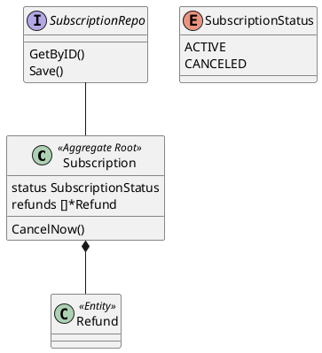

# Drawing Class Diagrams

Class diagrams should explain the important structure and behavior of a service, not reproduce every implementation detail. Check the actual domain and application code and existing service diagrams before drawing; preserve the documentation's notation and visual style.

## Workflow

1. Identify the diagram's audience, layer, and relevant types. Review neighboring service diagrams and the implementation for current names and relationships.
2. Show aggregates, entities, value objects, relevant repository and service interfaces, and meaningful domain operations. Group application commands and queries rather than drawing a separate class for each handler.
3. Keep only relationships that help explain the model. Use composition for owned children, associations for meaningful references, and dependencies for actual uses. Show enums as field types; group their definitions rather than drawing a line to every enum-typed field.
4. Match the existing PlantUML conventions, including color palette, stereotypes, Go syntax where applicable, and diagram identifiers. Arrange related types together and reduce crossing lines. Split diagrams by layer when needed.
5. Render or build the documentation and inspect the result where possible. Check that every displayed relationship and method matches the code and that links still work.

## Keep the diagram focused

| Include                                                        | Leave out                                                                  |
| -------------------------------------------------------------- | -------------------------------------------------------------------------- |
| Domain fields and meaningful business operations               | Event collections, event types, event-recording and event-draining methods |
| Value objects and enums that clarify the domain                | An edge for every enum-typed field or redundant getter                     |
| Repository and external service interfaces                     | Transaction plumbing such as unit-of-work and repository registry          |
| Provider event log when it is a relevant persistence interface | A separate rules section in a class-diagram page                           |
| Grouped command and query handlers                             | Separate boxes duplicating handlers already listed in the group            |

These omissions apply to class diagrams, not to event documentation or sequence diagrams. Keep important transaction and event semantics in the appropriate architecture or flow documentation rather than implying they do not exist. If a user explicitly requests an event or transaction diagram, show the details needed for that purpose.

## Example

The enum is visible in the field type without adding an extra edge. The event log, when relevant, is a separate interface; it is not a domain event.
