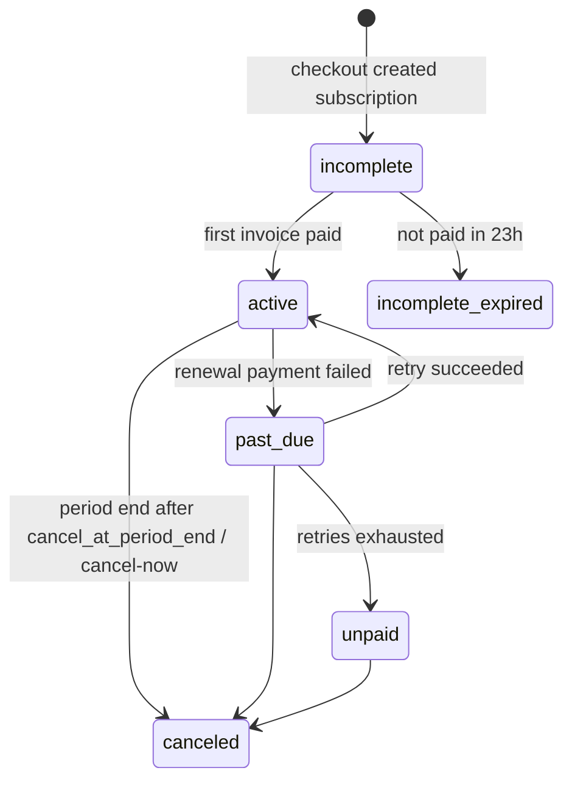
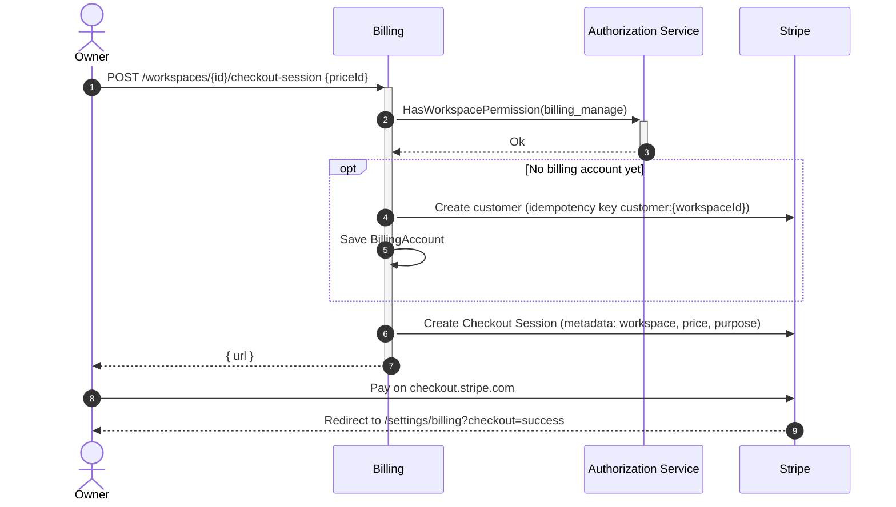
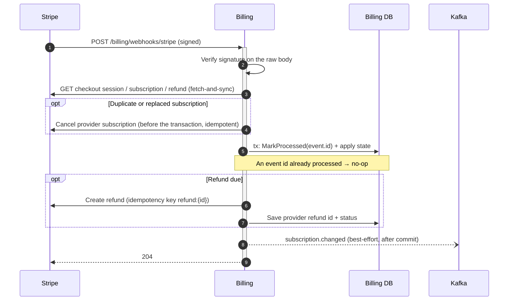
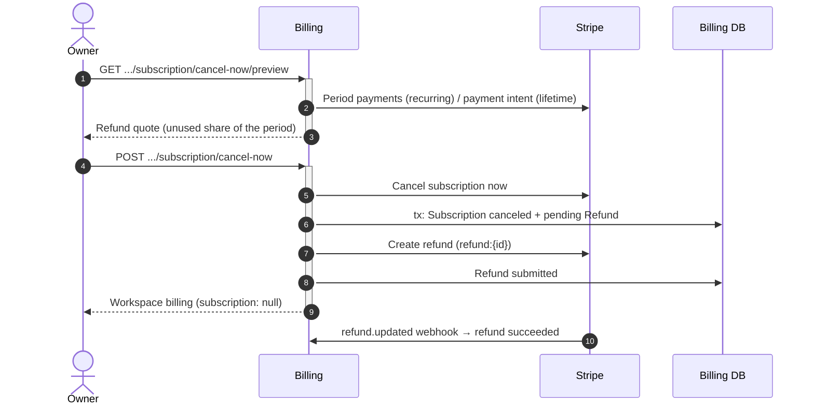
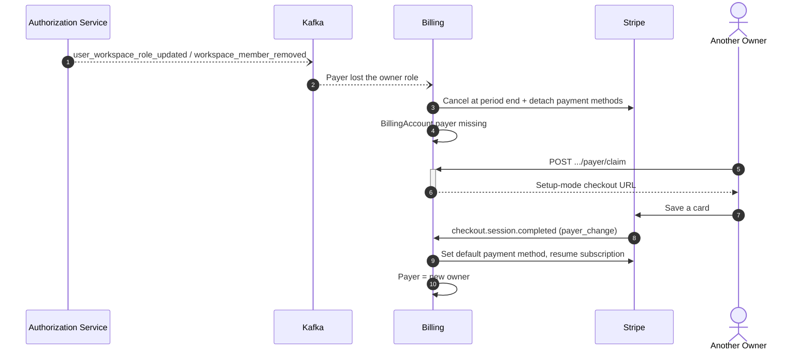

# Billing

:::info

- Stripe runs in **sandbox** only: Stripe doesn't onboard Vietnamese businesses for live payouts. See `story/BILLING_PAYMENT_PROVIDERS.md`.
- Webhooks are **fetch-and-sync**: the payload only gives an id, and billing reads the current state back from Stripe, so event order doesn't matter.
- Entitlements are always read from billing's own database. Other services call gRPC on every check and never cache.

:::

## Subscription States

`past_due` keeps paid features until period end + `pastDueGraceDays` (billing policy, default 3). Lifetime purchases have no Stripe subscription: they're created `active` and only leave it through cancel-now (refund window) or workspace deletion.

## Checkout

## Webhook Pipeline

Ordering rule for every webhook use case:

1. Provider mutations that must not be lost (cancel a duplicate subscription, change the default card) run **before** the write transaction and are idempotent.
2. The write transaction records the event (`processed_provider_events`) together with the state change.
3. Refunds run **after** commit. A refund that fails to submit stays `pending` without a provider id, and the hourly reconcile cron retries it.

## Cancel Now

## Payer Removed and Claimed

## Crons

| Job                               | Schedule                   | Effect                                                                                           |
| --------------------------------- | -------------------------- | ------------------------------------------------------------------------------------------------ |
| `billing:reconcile-subscriptions` | hourly                     | Re-syncs subscriptions past their period end or not synced for 24 h; retries unsubmitted refunds |
| `billing:prune-provider-events`   | daily 04:00 (process `TZ`) | Deletes processed webhook event ids older than 30 days                                           |

Both use a Redis lock (`billing_redis`), so with several billing instances each tick runs once.
