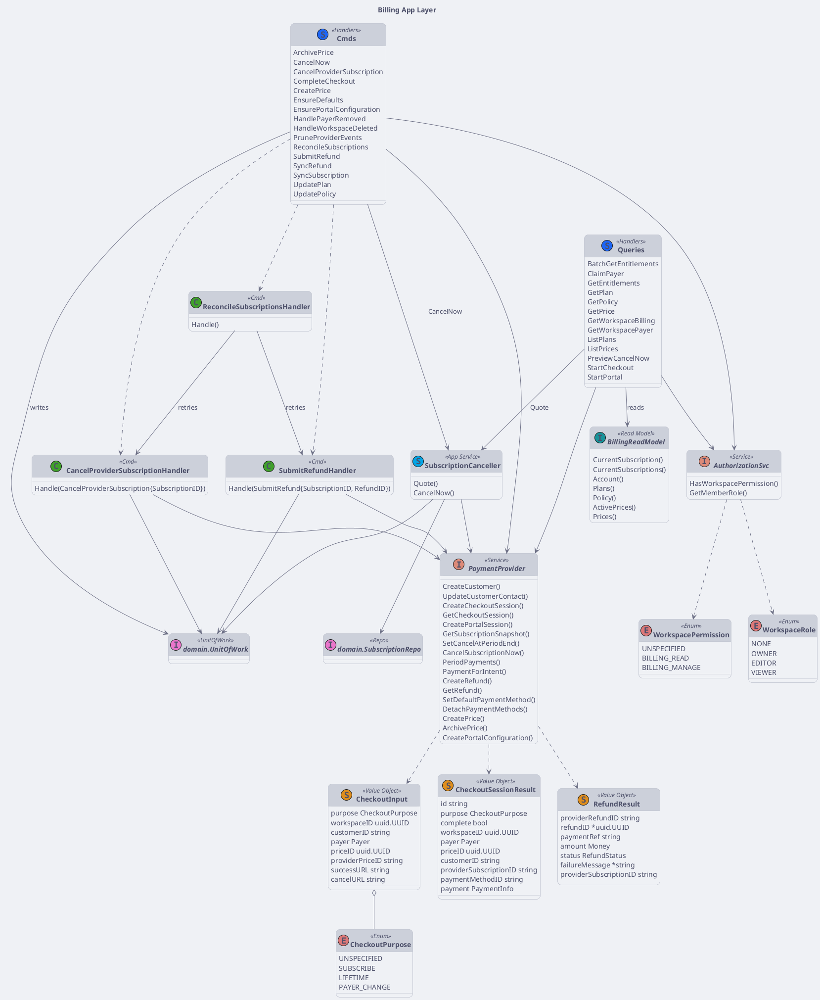

# Billing Class Diagram

:::info

- Golang syntax
- Apply DDD, CQRS, repository pattern, clean architecture
- Derived from `internal/billing/domain` and `internal/billing/app`

:::

## Rules

- **Aggregates**: `Subscription` (owns the child entity `Refund`, because "refunded total <= paid" is a subscription invariant), `BillingAccount`, `Price`, `Plan`, `BillingPolicy` (singleton). Each has its own repo.
- **Value objects are immutable**: unexported fields, validated constructors (`NewMoney`, `NewPayer`, `NewProviderSnapshot`, `NewPaymentInfo`, `NewRefundLine`, `NewRefundQuote`), getters only, defensive copies of pointers and slices. `Money` carries a `Currency` enum (VND only for now).
- **Aggregates raise events**: every mutating method records a domain event; `PopEvents` drains them on `Save`. `SubscriptionStateChangedEvent` is recorded whenever the plan or status changes, except on a duplicate checkout (`NewDuplicate*Subscription`), which never was the workspace's subscription. An external refund records only its settlement (`RefundSucceeded`/`RefundFailed`), never `RefundRequested`.
- **Writes go through `UnitOfWork.Execute`**, which hands out a `RepoRegistry` bound to one transaction. Events popped by `Save` are written to the outbox in that same transaction.
- **Reads use singleton repos**: the same repo interfaces are injected directly for reads (no transaction). Their `Save` and locking reads (`forUpdate = true`) fail outside a unit of work, so a write cannot silently run without a transaction.
- Provider webhook de-duplication (`ProviderEventLog`) is part of `RepoRegistry`, so "processed" commits together with its effect.
- Queries use `app.BillingReadModel` only; commands use `UnitOfWork`.

## Domain Layer

```plantuml
@startuml Billing
title Billing Domain

!$rosewater = "#dc8a78"
!$flamingo  = "#dd7878"
!$pink      = "#ea76cb"
!$mauve     = "#8839ef"
!$red       = "#d20f39"
!$maroon    = "#e64553"
!$peach     = "#fe640b"
!$yellow    = "#df8e1d"
!$green     = "#40a02b"
!$teal      = "#179299"
!$sky       = "#04a5e5"
!$sapphire  = "#209fb5"
!$lavender  = "#7287fd"
!$blue      = "#1e66f5"
!$text      = "#4c4f69"
!$subtext1  = "#5c5f77"
!$subtext0  = "#6c6f85"
!$overlay2  = "#7c7f93"
!$overlay1  = "#8c8fa1"
!$overlay0  = "#9ca0b0"
!$surface2  = "#acb0be"
!$surface1  = "#bcc0cc"
!$surface0  = "#ccd0da"
!$base      = "#eff1f5"
!$mantle    = "#e6e9ef"
!$crust     = "#dce0e8"

skinparam backgroundColor $base
skinparam defaultFontColor $text
skinparam roundcorner 16
skinparam classFontStyle bold

skinparam ArrowColor $subtext0
skinparam packageStyle rectangle

skinparam package {
    BackgroundColor $mantle
    BorderColor $surface1
    FontColor $mauve
}

skinparam class {
    BackgroundColor $base
    BorderColor $surface1
    HeaderBackgroundColor $surface0
    AttributeFontColor $text
}

!define RepoInterface(name) interface "name" as name <<(I, $pink) Repo>>
!define ServiceInterface(name) interface "name" as name <<(I, $rosewater) Service>>
!define Enum(name) enum "name" as name <<(E, $flamingo) Enum>>
!define ValueObject(name) class "name" as name <<(S, $yellow) Value Object>>
!define AggregateRoot(name) class "name" as name <<(S, $sky) Aggregate Root>>
!define RepoParam(name) class "name" as name <<(S, $green) Repo Param>>

skinparam backgroundColor $base
skinparam defaultFontColor $text
skinparam roundcorner 16
skinparam classFontStyle bold

skinparam ArrowColor $subtext0
skinparam packageStyle rectangle

skinparam package {
    BackgroundColor $mantle
    BorderColor $surface1
    FontColor $mauve
}

skinparam class {
    BackgroundColor $base
    BorderColor $surface1
    HeaderBackgroundColor $surface0
    AttributeFontColor $text
}

Enum(PlanTier) {
    UNSPECIFIED
    FREE
    PLUS
    PRO
}

Enum(Interval) {
    UNSPECIFIED
    MONTH
    YEAR
    LIFETIME
}

Enum(SubscriptionStatus) {
    NONE
    INCOMPLETE
    ACTIVE
    PAST_DUE
    UNPAID
    CANCELED
    INCOMPLETE_EXPIRED
}

Enum(RefundReason) {
    UNSPECIFIED
    CANCEL_NOW
    LIFETIME_WINDOW
    REPLACED_BY_LIFETIME
    WORKSPACE_DELETED
    DUPLICATE_CHECKOUT
    EXTERNAL
}

Enum(RefundStatus) {
    UNSPECIFIED
    PENDING
    SUCCEEDED
    FAILED
    CANCELED
}

Enum(Currency) {
    UNSPECIFIED
    VND
}

Enum(FeatureKey) {
    UNSPECIFIED
    AUTO_COMMIT
    WORKSPACE_GRAPH
}

Enum(LimitKey) {
    UNSPECIFIED
    MEMBERS
    PUBLISHED_NOTES
    NOTE_GRAPH_MAX_DEPTH
    AUTO_COMMIT_MIN_INTERVAL
    REVISION_HISTORY_DAYS
    TRASH_RETENTION_DAYS
    AI_CREDITS_MONTHLY
}

ValueObject(Money) {
    amount int64
    currency Currency

    Amount()
    Currency()
    Add()
}

ValueObject(Payer) {
    id string
    email string
    name string

    ID()
    Email()
    Name()
    WithContact()
}

ValueObject(ProviderSnapshot) {
    providerSubscriptionID string
    providerPriceID string
    workspaceID uuid.UUID
    status SubscriptionStatus
    currentPeriodStart time.Time
    currentPeriodEnd time.Time
    cancelAtPeriodEnd bool
    canceledAt *time.Time
}

ValueObject(PaymentInfo) {
    amount Money
    paymentRef string
    paidAt time.Time
    coverageStart time.Time
    coverageEnd time.Time
}

ValueObject(RefundLine) {
    paymentRef string
    paidAmount Money
    amount Money
    coverageSeconds int64
    unusedSeconds int64
}

ValueObject(RefundQuote) {
    amount Money
    unusedSeconds int64
    periodSeconds int64
    lines []RefundLine

    Lines()
}

ValueObject(Entitlements) {
    workspaceID uuid.UUID
    plan PlanTier
    status SubscriptionStatus
    accessUntil *time.Time
    features map[FeatureKey]bool
    limits map[LimitKey]int64
}

class "Refund" as Refund <<(E, $teal) Entity>> {
    id uuid.UUID
    providerRefundID *string
    paymentRef string
    amount Money
    reason RefundReason
    status RefundStatus
    failureMessage *string
    createdAt time.Time
    updatedAt time.Time

    AwaitingSubmission()
}

AggregateRoot(Subscription) {
    id uuid.UUID
    workspaceID uuid.UUID
    plan PlanTier
    interval Interval
    priceID uuid.UUID
    status SubscriptionStatus
    providerSubscriptionID *string
    providerPaymentID *string
    currentPeriodStart *time.Time
    currentPeriodEnd *time.Time
    cancelAtPeriodEnd bool
    canceledAt *time.Time
    pastDueSince *time.Time
    paidAt *time.Time
    providerSyncedAt time.Time
    refunds []*Refund
    events []Event

    NewSubscription()
    NewLifetimeSubscription()
    NewDuplicateSubscription()
    NewDuplicateLifetimeSubscription()
    ApplySnapshot()
    ScheduleCancel()
    ResumeCancel()
    QuoteCancelNow()
    CancelNow()
    UpdateRefund()
    FailRefund()
    RecordExternalRefund()
    AwaitingProviderCancel()
    MarkProviderSynced()
    IsCurrent()
    GrantsAccess()
    AccessUntil()
    PopEvents()
}

AggregateRoot(BillingAccount) {
    workspaceID uuid.UUID
    providerCustomerID string
    payer Payer
    payerMissingSince *time.Time
    events []Event

    OpenBillingAccount()
    ChangePayer()
    MarkPayerMissing()
    UpdateContact()
    PopEvents()
}

AggregateRoot(Price) {
    id uuid.UUID
    plan PlanTier
    interval Interval
    amount Money
    providerPriceID string
    providerLookupKey string
    active bool
    archivedAt *time.Time
    events []Event

    NewPrice()
    Archive()
    PopEvents()
}

AggregateRoot(Plan) {
    tier PlanTier
    features map[FeatureKey]bool
    limits map[LimitKey]int64
    events []Event

    NewPlan()
    Update()
    Feature()
    Limit()
    PopEvents()
}

AggregateRoot(BillingPolicy) {
    pastDueGraceDays int
    lifetimeRefundWindowDays int
    portalConfigurationID *string
    events []Event

    Update()
    SetPortalConfiguration()
    PopEvents()
}

class "ResolveEntitlements" as ResolveEntitlements <<(F, $lavender) Function>> {
    (sub, plans, policy, now) Entitlements
}

interface "Event" as Event <<(I, $maroon) Domain Event>> {
    GetID()
    GetAggregateID()
    GetUserID()
}

class "SubscriptionStateChangedEvent" as SubscriptionStateChangedEvent <<(V, $maroon) Event>> {
    workspaceID uuid.UUID
    plan PlanTier
    status SubscriptionStatus
}

class "SubscriptionCanceledNowEvent" as SubscriptionCanceledNowEvent <<(V, $maroon) Event>> {
    reason RefundReason
}

class "RefundRequestedEvent" as RefundRequestedEvent <<(V, $maroon) Event>> {
    refundID uuid.UUID
    amount Money
}

class "Other events" as OtherEvents <<(V, $maroon) Event>> {
    SubscriptionCreated
    SubscriptionActivated
    SubscriptionRenewed
    SubscriptionPastDue
    SubscriptionPlanChanged
    SubscriptionCancelScheduled
    SubscriptionCancelResumed
    SubscriptionEnded
    RefundSucceeded
    RefundFailed
    BillingAccountOpened
    PayerChanged
    PayerMissing
    BillingContactUpdated
    PriceCreated
    PriceArchived
    PlanUpdated
    BillingPolicyUpdated
    PortalConfigurationChanged
}

RepoInterface(SubscriptionRepo) {
    GetByID()
    GetCurrentByWorkspace()
    GetByProviderSubscriptionID()
    GetByProviderPaymentID()
    GetByRefundID()
    ListCurrentByWorkspaces()
    ListNeedingReconcile()
    ListCanceledAwaitingProviderCancel()
    ListIDsWithUnsubmittedRefunds()
    Save()
}

RepoInterface(BillingAccountRepo) {
    GetByWorkspace()
    ListByPayer()
    Save()
}

RepoInterface(PriceRepo) {
    GetByID()
    GetByProviderPriceID()
    GetActive()
    ListActive()
    List()
    Save()
}

RepoInterface(PlanRepo) {
    Get()
    ListMap()
    Save()
}

RepoInterface(BillingPolicyRepo) {
    Get()
    Save()
}

RepoInterface(ProviderEventLog) {
    MarkProcessed()
    PruneBefore()
}

interface "RepoRegistry" as RepoRegistry <<(I, $pink) Registry>> {
    Subscription()
    BillingAccount()
    Price()
    Plan()
    BillingPolicy()
    ProviderEventLog()
}

interface "UnitOfWork" as UnitOfWork <<(I, $pink) UnitOfWork>> {
    Execute(fn func(RepoRegistry) error)
}

Subscription *-- Refund
Subscription o-- ProviderSnapshot : applies
Subscription ..> RefundQuote : quotes
Subscription ..> PaymentInfo : quotes from
Subscription --> Price : priceID
Subscription ..> BillingPolicy : GrantsAccess
RefundQuote *-- RefundLine
RefundLine o-- Money
RefundQuote o-- Money
PaymentInfo o-- Money
Refund o-- Money
Price o-- Money
Money o-- Currency
BillingAccount o-- Payer
BillingAccount "1" -- "0..*" Subscription : workspaceID
Price --> Plan : tier
Plan o-- FeatureKey
Plan o-- LimitKey
Subscription o-- SubscriptionStatus
Subscription o-- Interval
Subscription o-- PlanTier
Refund o-- RefundReason
Refund o-- RefundStatus
ResolveEntitlements ..> Subscription
ResolveEntitlements ..> Plan
ResolveEntitlements ..> BillingPolicy
ResolveEntitlements ..> Entitlements

SubscriptionStateChangedEvent ..|> Event
SubscriptionCanceledNowEvent ..|> Event
RefundRequestedEvent ..|> Event
OtherEvents ..|> Event
Subscription ..> SubscriptionStateChangedEvent : records
Subscription ..> SubscriptionCanceledNowEvent : records
Subscription ..> RefundRequestedEvent : records
Subscription ..> OtherEvents : records

SubscriptionRepo -- Subscription
BillingAccountRepo -- BillingAccount
PriceRepo -- Price
PlanRepo -- Plan
BillingPolicyRepo -- BillingPolicy
RepoRegistry o-- SubscriptionRepo
RepoRegistry o-- BillingAccountRepo
RepoRegistry o-- PriceRepo
RepoRegistry o-- PlanRepo
RepoRegistry o-- BillingPolicyRepo
RepoRegistry o-- ProviderEventLog
UnitOfWork ..> RepoRegistry
@enduml
```

<!-- diagram id="class-diagram-billing-domain" -->

## Application Layer

`CancelNow` only records the local cancellation and refund requests. The provider side effects are separate commands driven by billing's own outbox events (see [Flows](./flows#cancel-now)).

<!-- diagram id="class-diagram-billing-application" -->
