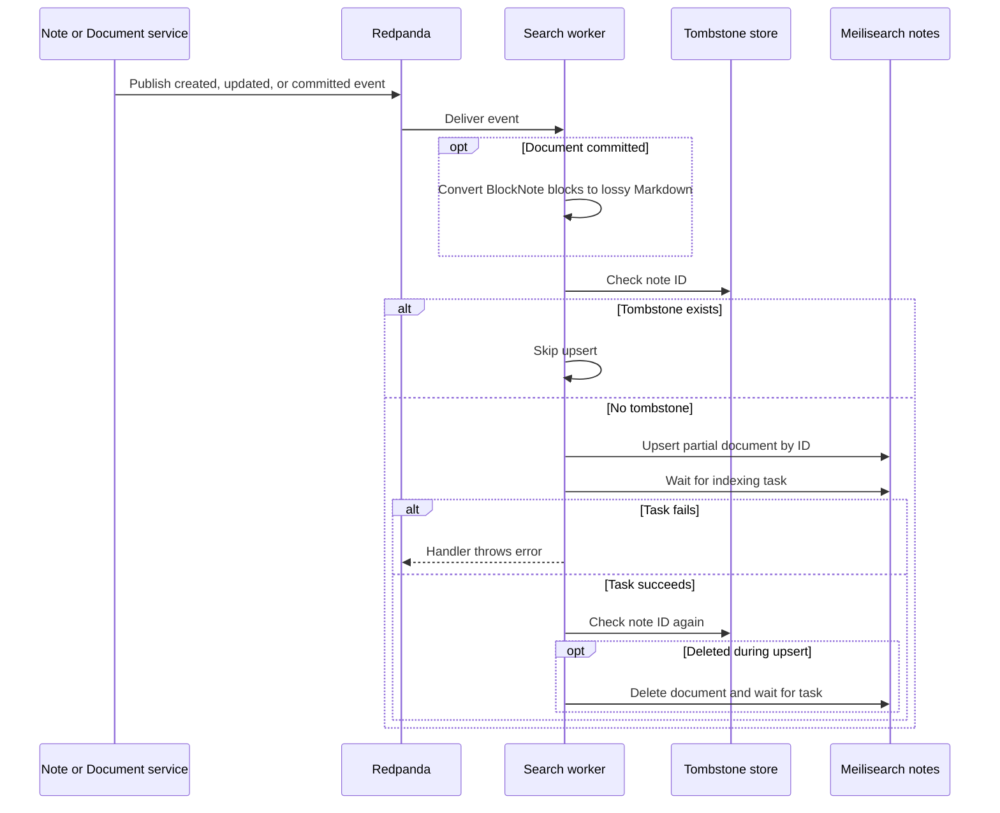
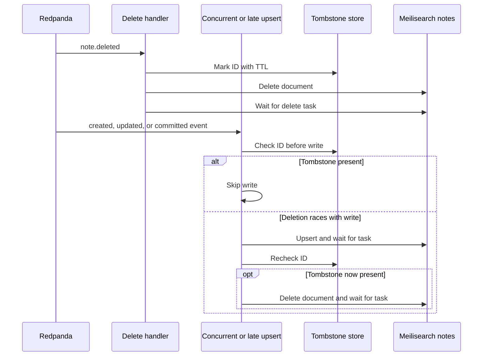
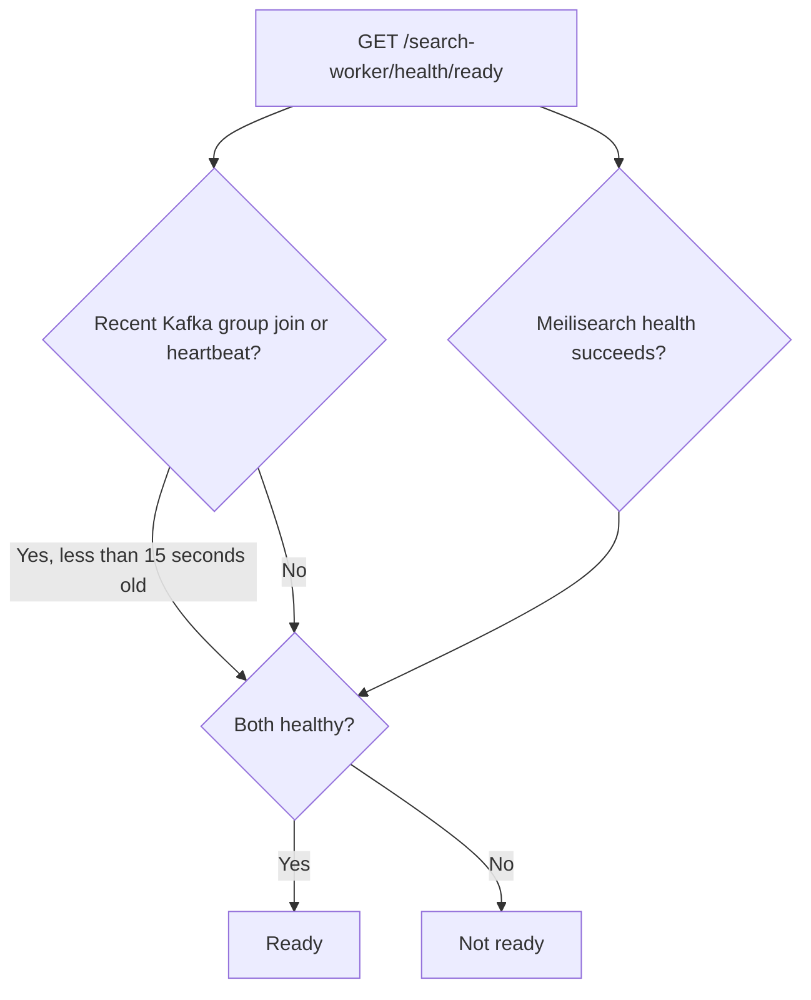

# Search Worker Flows

These flows describe the asynchronous projection into Meilisearch, not a transactional search
index. See the [worker overview](./) for event topics, configuration, and operating limits.

## Index metadata and committed content

Created events supply `name` and `workspaceId`; updates supply name, folder, and trashed
state; commits supply tags and `plainTextContent`. These partial writes can arrive in either
order. Search can lag events, and edits are not reflected until a document commit.

## Delete and late events

The second check handles a deletion that happens after the first check. Protection is bounded
by tombstone lifetime and, for memory storage, cache capacity and process lifetime; Redis
shares tombstones between worker instances. Events arriving after protection expires can
recreate a deleted record.

## Health and recovery

Disconnect, stop, crash, rebalance, and request timeout mark Kafka down. A subsequent group
join or heartbeat restores the Kafka indicator. The HTTP listener starts independently of
Kafka, and Kafka startup failures are retried. Liveness reports process health without checking
these dependencies.
