# Billing 03 — Billing service

> Sub-project 3 of 4. Depends on 02 (foundations) and on 01's `workspace.deleted` event.
> Order: 01 + 02 (parallel) → 03 → 04. Progress is tracked by the task checkboxes in each plan under `docs/superpowers/plans/`.
> Decisions come from the grilling session 2026-10-10/11 (`tmp/BILLING_SPEC.md`, Part 1).

## Goal

A new Go `billing` service (DDD + CQRS, like `internal/note`) that owns plans, prices,
subscriptions and entitlements, integrates Stripe (sandbox) through hosted Checkout and
Customer Portal, and exposes entitlements over gRPC and HTTP. End to end: config, OTLP,
health, Postgres + goose + sqlc, Kafka consumers, cron, compose, Traefik.

## 0. Decision summary

| Topic | Decision |
| --- | --- |
| Billed entity | Workspace. One **payer** (`payerId`, AWS term) per workspace; payer must be a workspace owner. Any owner may manage billing. |
| Provider | Stripe, **test mode / sandbox only**. Stripe does not onboard Vietnam-registered businesses for live payouts. Provider sits behind `app.PaymentProvider` so a VN gateway can replace it. |
| SDK | `github.com/stripe/stripe-go/v87` (MIT, free). |
| Stripe Customer | One per **workspace**, mapping stored only in billing DB. Authentik is not touched. |
| Stripe UI | Stripe-hosted **Checkout** (purchase, card replacement) + Stripe-hosted **Customer Portal** (card, invoices, cancel at period end, plan switch). Our API only does what those cannot. |
| Product type | Stripe Billing subscriptions (`mode=subscription`) for month/year; one-time Price (`mode=payment`) for lifetime. No raw PaymentIntents. |
| Tiers | `free`, `plus`, `pro`. Lifetime grants `pro`. |
| Intervals | `month`, `year` (≈20% off, separate Price), `lifetime`. |
| Currency | VND only (zero-decimal). Schema keeps `currency` so other currencies can be added as rows. |
| Catalog | Feature/limit **keys** are enums in code. Their **values** per plan, the billing policy, and all prices live in the billing DB and are **admin-editable** via API. Prices are grandfathered; plan limits apply immediately. |
| Admin | One app-wide admin group from config (`NOTOPIA_{SERVICE}_ADMIN_GROUP`, default `notopia-admins`), read from `X-Forwarded-Groups`. |
| Entitlements | Billing returns plan + resolved features + limits. Frontend hardcodes nothing numeric. |
| Enforcement | note / document (later AI) call billing gRPC directly on every check, **no cache**. Billing publishes no integration events. Errors → HTTP 402 conforming to `Error`. |
| Expiry | No "expire at period end" job. Webhooks drive state; hourly reconcile cron is the safety net; `past_due` keeps access for a grace period. |
| Refund | Immediate cancel → prorated refund. Lifetime → full refund within a window, none after. |
| Cron | Inside each service, `controller/cron/`, Redis-locked. `// NOTE:` to move into `cmd/{svc}-worker` later. |
| System actor | Authentik service account per service (`note-service` 1001, `document-service` 1002, `billing-service` 1003). No `"system"` string. |
| Trial | None (TODO). |

---


## 1. Placement

Mirrors `internal/note` (DDD + CQRS, sqlc + goose, wire). No outbox: billing publishes no
integration events.

```
api/billing/                         # OpenAPI (paths/ + components/), oapi-codegen-server.yaml, oapi-codegen-model.yaml
proto/billing/billing.proto
cmd/billing/{main,wire,wire_gen,metadata}.go     # the service (nx: billing)
cmd/billingseed/{main,wire,wire_gen}.go          # one-shot seeder (nx: billingseed), like cmd/notecreateseed
internal/billing/
  AGENTS.md
  config/
  domain/
    plan.go  planrepo.go
    price.go  pricerepo.go
    billingaccount.go  billingaccountrepo.go
    subscription.go  refund.go  subscriptionrepo.go
    billingpolicy.go  billingpolicyrepo.go
    entitlement.go           # FeatureKey, LimitKey, Entitlements VO, EntitlementResolver
    money.go  refundquote.go  providersnapshot.go
    event.go  uow.go  wire.go
  app/
    cmd_*.go  q_*.go  e_*.go
    svc_paymentprovider.go   # port
    svc_authorization.go     # port (owner / member checks)
    svc_providereventinbox.go
    readmodel.go  model.go  wire.go
  errs/
  infra/
    payment/stripe/          # PaymentProvider adapter, webhook signature verify, snapshot mapping
    persistence/pgmigration/ persistence/pgsqlc/ persistence/pgrepo/ persistence/pgreadmodel/ persistence/pginbox/
    service/authorization.go # gRPC client
  controller/
    http/   grpc/   event/   cron/   health/
```

Infra: `deploy/compose/services/billing.yaml` (`billing_postgresql`, `billing_redis`),
`deploy/compose/infrastructure/traefik/dynamic/billing.yaml`, `cmd/billing/project.json`,
`api/billing/project.json`, registration in `api/openapi.yaml`, `api/redocly.yaml`.

## 2. Stripe usage

### 2.1 Objects we create (all through code, never the dashboard)

| Stripe object | Created by | Key / metadata |
| --- | --- | --- |
| Product per paid tier | `seed` | `metadata.tier`, id `notopia_plus`, `notopia_pro` |
| Price | `seed`, admin `CreatePrice` | `lookup_key = {tier}_{interval}`, `transfer_lookup_key=true` on replace, `metadata.price_id` (our uuid). Recurring for month/year, one-time for lifetime. |
| Customer | `StartCheckout` (first time) | idempotency key `customer:{workspaceId}`, `metadata.workspace_id`, email/name = payer |
| Checkout Session | `StartCheckout`, `ChangePayer` | `client_reference_id = workspaceId`; `metadata {workspace_id, payer_id, price_id, purpose}` where `purpose ∈ subscribe, lifetime, payer_change` |
| Subscription | Stripe (from Checkout) | `subscription_data.metadata.workspace_id` |
| Portal configuration | `seed`, after every price change | id stored in `billing_policy.portal_configuration_id` |
| Portal session | `StartPortal` | `configuration`, `return_url` |
| Refund | `CancelNow`, `CompleteCheckout` (duplicate), lifetime refund | idempotency key `refund:{refundId}`, `metadata.refund_id` |

Prices are immutable in Stripe. "Changing a price" = new Price + archive old. Existing
subscriptions keep the old Price (grandfathered). New checkouts resolve by `lookup_key`.

### 2.2 Portal configuration

- `payment_method_update`: enabled
- `invoice_history`: enabled
- `customer_update`: disabled (email/name managed by us from the payer)
- `subscription_cancel`: enabled, `mode=at_period_end`
- `subscription_update`: enabled; products = paid tiers with their active recurring prices;
  `proration_behavior=always_invoice` (upgrade charges the difference now);
  `schedule_at_period_end.conditions = [decreasing_item_amount, shortening_interval]`
  (downgrade and year→month take effect at period end, never refund)

### 2.3 API-version gotchas (verify against v87 while coding)

- Since `2025-03-31.basil`, `current_period_start/end` live on **subscription items**
  (`items.data[0].current_period_end`), not the subscription.
- Since basil, invoices expose payments via `invoice.payments` (InvoicePayment), not
  `invoice.payment_intent`. Refund targets = the PaymentIntent of each paid invoice payment of the current period.
- VND is zero-decimal: `amount: 49000` = 49.000₫.

### 2.4 Local development

- Stripe sandbox (free), test cards.
- `stripe listen --forward-to api.notopia.localhost/billing/webhooks/stripe` → prints the
  webhook secret for `.env.local`.
- `just billing-seed` → `nx run billingseed:run` (idempotent; inserts defaults only when empty).
- `stripe-mock` is not used (no webhooks).

## 3. Plans, features, limits

Keys are enums in code (`domain/entitlement.go`). Admin edits values only; unknown keys are
rejected. `-1` = unlimited. Defaults written by `seed`:

| Key | Kind | Meaning | free | plus | pro |
| --- | --- | --- | --- | --- | --- |
| `auto_commit` | feature | document auto-commits revisions | ✗ | ✓ | ✓ |
| `workspace_graph` | feature | whole-workspace graph endpoint | ✗ | ✓ | ✓ |
| `members` | limit | max members per workspace | 3 | 10 | -1 |
| `published_notes` | limit | max published notes per workspace | 3 | -1 | -1 |
| `note_graph_max_depth` | limit | depth clamp on note graph | 5 | -1 | -1 |
| `auto_commit_min_interval_seconds` | limit | min gap between auto revisions | 0 | 300 | 60 |
| `revision_history_days` | limit | revisions older than this are purged (latest always kept) | 7 | 30 | -1 |
| `trash_retention_days` | limit | trashed items older than this are purged | 7 | 30 | 90 |
| `ai_credits_monthly` | limit | AI quota, enforced by the future AI service | 0 | 200 | 2000 |

Custom slug is free for everyone (not a key). Storage quota and owned-workspace count are not
limits.

Default prices (VND, admin-editable):

| lookup_key | amount |
| --- | --- |
| `plus_month` | 49 000 |
| `plus_year` | 470 400 (49 000 × 12 × 0.8) |
| `pro_month` | 99 000 |
| `pro_year` | 950 400 |
| `pro_lifetime` | 2 490 000 (placeholder) |

Billing policy defaults (admin-editable): `pastDueGraceDays = 3`,
`lifetimeRefundWindowDays = 14`.

## 4. Domain model

### 4.1 Aggregates

| Aggregate root | Contains | Repo |
| --- | --- | --- |
| `Subscription` | child entity `Refund`; VOs `Money`, `ProviderSnapshot`, `RefundQuote` | `SubscriptionRepo` |
| `BillingAccount` | payer + provider customer | `BillingAccountRepo` |
| `Price` | `Money` | `PriceRepo` |
| `Plan` | features / limits maps | `PlanRepo` |
| `BillingPolicy` | singleton | `BillingPolicyRepo` |

`Refund` lives inside `Subscription` because "refunded total ≤ paid" is a subscription invariant.
Idempotency of webhooks is **not** domain: it is an app port `ProviderEventInbox`.

`Entitlements` is a value object computed by the domain service `EntitlementResolver` from
`Subscription` (nullable → free) + `Plan` + `BillingPolicy`.

Enums (`PlanTier`, `Interval`, `Status`, `RefundReason`, `RefundStatus`, `FeatureKey`,
`LimitKey`, and app-level `WorkspaceRole`, `WorkspacePermission`, `CheckoutPurpose`,
`WebhookEventType`) follow the note convention (`internal/note/domain/trashed.go`): `type X uint8`,
`iota` consts with zero `XUnspecified` (`StatusNone`, `WorkspaceRoleNone`, `WebhookIgnored` where
"none" is a real state), `IsValid()` and `String()`. `String()` yields the snake-case names used
on the wire and in logs. Every port maps explicitly (`toX`/`fromX`), never by casting: Postgres
enums ↔ sqlc string types in `pgrepo`, OpenAPI enums in HTTP `mapin`/`mapout`, proto enums
(`PlanTier`, `SubscriptionStatus`) in gRPC `mapout`, `api/share` in the notifier, Stripe
statuses/metadata in the Stripe adapter. Consumers (note, document) map the proto enums into their
own local types. Feature/limit keys cross ports as `k.String()` and come back through
`ParseFeatureKey` / `ParseLimitKey`: admin HTTP input rejects unknown keys (400), while reading
plan JSONB skips unknown keys with a warning. `IsValid()` is false for `Unspecified`, deliberately
unlike note's `TrashedBy`. `errs.Code` stays a `string` because it is itself the wire error code.

### 4.2 Class diagram

```mermaid
classDiagram
  direction TB

  class Subscription {
    <<aggregate root>>
    -id uuid
    -workspaceID uuid
    -plan PlanTier
    -interval Interval
    -priceID uuid
    -status Status
    -providerSubscriptionID *string
    -providerPaymentID *string
    -currentPeriodStart *time
    -currentPeriodEnd *time
    -cancelAtPeriodEnd bool
    -canceledAt *time
    -paidAt *time
    -providerSyncedAt time
    -refunds []*Refund
    +NewSubscription(...) SubscriptionCreated
    +NewLifetimeSubscription(...) SubscriptionCreated
    +ApplySnapshot(ProviderSnapshot, actor) SubscriptionActivated|Renewed|PastDue|PlanChanged|CancelScheduled|CancelResumed|Ended
    +ScheduleCancel(actor) SubscriptionCancelScheduled
    +ResumeCancel(actor) SubscriptionCancelResumed
    +QuoteCancelNow(now, policy, payments) RefundQuote
    +CancelNow(now, reason, quote, actor) SubscriptionCanceledNow + RefundRequested per line
    +MarkRefundSucceeded(refundID, providerRefundID) RefundSucceeded
    +MarkRefundFailed(refundID, msg) RefundFailed
    +RecordExternalRefund(...) RefundSucceeded
    +GrantsAccess(now, policy) bool
    +AccessUntil(policy) *time
    +IsCurrent() bool
    +PopEvents() []Event
  }

  class Refund {
    <<entity>>
    -id uuid
    -providerRefundID *string
    -amount Money
    -reason RefundReason
    -status RefundStatus
    -failureMessage *string
    -createdAt time
  }

  class BillingAccount {
    <<aggregate root>>
    -workspaceID uuid
    -providerCustomerID string
    -payerID string
    -payerEmail string
    -payerName string
    -payerMissingSince *time
    +OpenBillingAccount(...) BillingAccountOpened
    +ChangePayer(userID, email, name, actor) PayerChanged
    +MarkPayerMissing(now, actor) PayerMissing
    +UpdateContact(email, name, actor) BillingContactUpdated
    +PopEvents() []Event
  }

  class Price {
    <<aggregate root>>
    -id uuid
    -plan PlanTier
    -interval Interval
    -amount Money
    -providerPriceID string
    -lookupKey string
    -active bool
    -createdAt time
    -archivedAt *time
    +NewPrice(...) PriceCreated
    +Archive(actor) PriceArchived
    +PopEvents() []Event
  }

  class Plan {
    <<aggregate root>>
    -tier PlanTier
    -features map~FeatureKey,bool~
    -limits map~LimitKey,int64~
    -updatedAt time
    +Update(features, limits, actor) PlanUpdated
    +Feature(FeatureKey) bool
    +Limit(LimitKey) int64
    +PopEvents() []Event
  }

  class BillingPolicy {
    <<aggregate root, singleton>>
    -pastDueGraceDays int
    -lifetimeRefundWindowDays int
    -portalConfigurationID *string
    +Update(...) BillingPolicyUpdated
    +SetPortalConfiguration(id) PortalConfigurationChanged
    +PopEvents() []Event
  }

  class Money {
    <<value>>
    amount int64
    currency string
  }

  class RefundQuote {
    <<value>>
    amount Money
    unusedSeconds int64
    periodSeconds int64
    lines []RefundLine
  }

  class RefundLine {
    <<value>>
    paymentRef string
    paidAmount Money
    amount Money
    coverageSeconds int64
    unusedSeconds int64
  }

  class ProviderSnapshot {
    <<value>>
    providerSubscriptionID string
    status Status
    priceLookupKey string
    currentPeriodStart time
    currentPeriodEnd time
    cancelAtPeriodEnd bool
    canceledAt *time
  }

  class Entitlements {
    <<value>>
    workspaceID uuid
    plan PlanTier
    status Status
    accessUntil *time
    features map~FeatureKey,bool~
    limits map~LimitKey,int64~
  }

  class EntitlementResolver {
    <<domain service>>
    +Resolve(sub *Subscription, plans, policy, now) Entitlements
  }

  class PlanTier { <<enum>> free plus pro }
  class Interval { <<enum>> month year lifetime }
  class Status { <<enum>> incomplete active past_due unpaid canceled incomplete_expired }
  class RefundReason { <<enum>> cancel_now lifetime_window replaced_by_lifetime workspace_deleted duplicate_checkout external }
  class RefundStatus { <<enum>> pending succeeded failed canceled }
  class FeatureKey { <<enum>> auto_commit workspace_graph }
  class LimitKey { <<enum>> members published_notes note_graph_max_depth auto_commit_min_interval_seconds revision_history_days trash_retention_days ai_credits_monthly }

  Subscription *-- Refund
  Subscription --> Price : priceID
  Subscription ..> RefundQuote
  Subscription ..> ProviderSnapshot
  BillingAccount "1" -- "0..*" Subscription : workspaceID
  Price --> Plan : tier
  EntitlementResolver ..> Subscription
  EntitlementResolver ..> Plan
  EntitlementResolver ..> BillingPolicy
  EntitlementResolver ..> Entitlements
```



### 4.3 Domain events

Every mutating method emits an event (`BaseEvent{ID, OccurredAt, AggregateID, UserID}`;
`UserID` = acting user or the billing service account `1003`).

| Aggregate | Events |
| --- | --- |
| Subscription | `SubscriptionCreated`, `SubscriptionActivated`, `SubscriptionRenewed`, `SubscriptionPastDue`, `SubscriptionPlanChanged`, `SubscriptionCancelScheduled`, `SubscriptionCancelResumed`, `SubscriptionCanceledNow`, `SubscriptionEnded`, `RefundRequested`, `RefundSucceeded`, `RefundFailed` |
| BillingAccount | `BillingAccountOpened`, `PayerChanged`, `PayerMissing`, `BillingContactUpdated` |
| Price | `PriceCreated`, `PriceArchived` |
| Plan | `PlanUpdated` |
| BillingPolicy | `BillingPolicyUpdated`, `PortalConfigurationChanged` |

`ApplySnapshot` diffs old vs new state and emits only the events that apply.

### 4.4 Rules

**Access** (`GrantsAccess`):

- `interval = lifetime` and `status = active` → true, `AccessUntil = nil`.
- `status = active` → true (also while `cancelAtPeriodEnd`; Stripe sends
  `customer.subscription.deleted` at period end).
- `status = past_due` and `now < pastDueSince + pastDueGraceDays` → true. `pastDueSince` is set when a
  snapshot moves the subscription into `past_due` and cleared when it leaves; rows without it fall
  back to `currentPeriodStart`. `AccessUntil` is `pastDueSince + pastDueGraceDays`.
- otherwise false → resolver returns the `free` plan with `status` preserved for UI.

Why no local expiry: at period end Stripe creates the renewal invoice, finalizes it about 1 h
later, then charges; failures move to `past_due` and Smart Retries continue for up to ~2 weeks.
Our stored period end always passes before the renewal webhook arrives, which is why an `active`
subscription keeps access. After a failed renewal Stripe has already advanced the period, so the
stored period end is the next one; the grace is therefore measured from `past_due_since`, not from
the period end.

**Refund quote** (`QuoteCancelNow`):

- recurring: one line per paid invoice payment whose coverage overlaps the current period. An
  upgrade is invoiced immediately (`always_invoice`), so a period can hold the renewal payment
  plus proration payments. Each payment covers its own window (its invoice line periods, **not**
  clipped to the current period): `line = amount × unused / coverage`, floored (VND integer), where
  `coverage = coverageEnd − coverageStart` and `unused = max(0, coverageEnd − max(now, coverageStart))`.
  Quote amount = sum of lines; cancel-now creates one `Refund` per line (Stripe refunds per
  PaymentIntent). Example: Plus 100k paid day 1–30, upgrade on day 10 invoiced ≈133k for
  day 10–30, cancel on day 20 → 33k + 66k ≈ 100k (= 10 unused days of Pro).
  A month→year change in the Portal resets the period to `[t, t+1y]` and credits the unused
  monthly time into the yearly invoice, so the original monthly invoice (created before the new
  period) still counts with its own window: cancelling right away refunds the unused half month
  of the monthly payment plus the yearly invoice, i.e. the full yearly price. Because of this the
  adapter looks back one longest interval (1y + 1d) for invoices and filters by coverage overlap;
  a payment of the previous period (coverage ends at the period start) contributes 0.
- lifetime: full `amount` if `now − paidAt ≤ lifetimeRefundWindowDays`, else error
  `refundWindowExpired` (cancel-now rejected).
- Invariant: per payment, sum of non-failed refunds against it ≤ that payment's amount.

**One current subscription per workspace**: current = status not in
(`canceled`, `incomplete_expired`). History rows are kept; re-subscribe creates a new row.

**Payer** must be a workspace owner. Lifetime subscriptions never charge again, so a missing
payer has no effect on them.

## 5. Repositories and ports

```go
// domain
type SubscriptionRepo interface {
	GetByID(ctx context.Context, id uuid.UUID, forUpdate bool) (*Subscription, error)
	GetCurrentByWorkspace(ctx context.Context, workspaceID uuid.UUID, forUpdate bool) (*Subscription, error)
	GetByProviderSubscriptionID(ctx context.Context, id string, forUpdate bool) (*Subscription, error)
	GetByProviderRefundID(ctx context.Context, id string, forUpdate bool) (*Subscription, error)
	ListCurrentByWorkspaces(ctx context.Context, workspaceIDs []uuid.UUID) ([]*Subscription, error)
	ListNeedingReconcile(ctx context.Context, now time.Time, limit int) ([]*Subscription, error)
	Save(ctx context.Context, s *Subscription) error // upserts refunds too
}

type BillingAccountRepo interface {
	GetByWorkspace(ctx context.Context, workspaceID uuid.UUID, forUpdate bool) (*BillingAccount, error)
	ListByPayer(ctx context.Context, payerID string) ([]*BillingAccount, error)
	Save(ctx context.Context, a *BillingAccount) error
}

type PriceRepo interface {
	GetByID(ctx context.Context, id uuid.UUID, forUpdate bool) (*Price, error)
	GetByProviderPriceID(ctx context.Context, id string) (*Price, error)
	GetActive(ctx context.Context, plan PlanTier, interval Interval, currency string) (*Price, error)
	ListActive(ctx context.Context) ([]*Price, error)
	Save(ctx context.Context, p *Price) error
}

type PlanRepo interface {
	Get(ctx context.Context, tier PlanTier, forUpdate bool) (*Plan, error)
	List(ctx context.Context) ([]*Plan, error)
	Save(ctx context.Context, p *Plan) error
}

type BillingPolicyRepo interface {
	Get(ctx context.Context, forUpdate bool) (*BillingPolicy, error)
	Save(ctx context.Context, p *BillingPolicy) error
}

type RepoRegistry interface {
	Subscription() SubscriptionRepo
	BillingAccount() BillingAccountRepo
	Price() PriceRepo
	Plan() PlanRepo
	BillingPolicy() BillingPolicyRepo
}

type UnitOfWork interface {
	Execute(ctx context.Context, fn func(RepoRegistry) error) error
}
```

```go
// app ports
type PaymentProvider interface {
	CreateCustomer(ctx context.Context, in CreateCustomerInput) (customerID string, err error)
	UpdateCustomerContact(ctx context.Context, customerID, email, name string) error
	CreateCheckoutSession(ctx context.Context, in CheckoutInput) (url string, err error) // subscribe | lifetime | payer_change
	CreatePortalSession(ctx context.Context, customerID, configurationID, returnURL string) (url string, err error)
	GetSubscriptionSnapshot(ctx context.Context, providerSubscriptionID string) (domain.ProviderSnapshot, error)
	GetCheckoutSession(ctx context.Context, id string) (CheckoutSessionResult, error)
	CancelSubscriptionNow(ctx context.Context, providerSubscriptionID string) error
	PeriodPayments(ctx context.Context, providerSubscriptionID string, periodStart, periodEnd time.Time) ([]PaymentInfo, error) // paid invoice payments overlapping the period, with coverage
	CreateRefund(ctx context.Context, refundID uuid.UUID, paymentRef string, amount domain.Money) (providerRefundID string, err error)
	SetDefaultPaymentMethod(ctx context.Context, customerID, paymentMethodID string, providerSubscriptionID *string) error
	DetachPaymentMethodsExcept(ctx context.Context, customerID, keepPaymentMethodID string) error
	DetachAllPaymentMethods(ctx context.Context, customerID string) error
	UpsertProductAndPrice(ctx context.Context, p *domain.Price) (providerPriceID string, err error)
	ArchivePrice(ctx context.Context, providerPriceID string) error
	UpsertPortalConfiguration(ctx context.Context, existingID *string, prices []*domain.Price) (id string, err error)
	ParseWebhook(payload []byte, signature string) (WebhookEvent, error)
}

type ProviderEventInbox interface {
	MarkProcessed(ctx context.Context, eventID, eventType string) (firstTime bool, err error)
}

type AuthorizationService interface { // gRPC to authorization
	GetWorkspaceRole(ctx context.Context, userID string, workspaceID uuid.UUID) (WorkspaceRole, error)
}
```

`WebhookEvent` is a provider-neutral struct: `{ID, Type, ObjectID, Metadata}` with `Type` one of
our own constants (`CheckoutCompleted`, `SubscriptionChanged`, `InvoicePaid`,
`InvoicePaymentFailed`, `RefundUpdated`, `Ignored`). The Stripe adapter does the mapping.

## 6. Use cases

| File | Trigger | Behaviour |
| --- | --- | --- |
| `cmd_startcheckout.go` | HTTP | Owner check. Load or open `BillingAccount` (creates Stripe Customer). Reject `409 subscriptionAlreadyActive` if a current subscription exists, unless buying lifetime. Resolve active Price. Create Checkout (`subscription` or `payment`). Return URL. |
| `cmd_startportal.go` | HTTP | Owner check. Requires a `BillingAccount`. Return Portal URL. |
| `cmd_cancelnow.go` | HTTP | Owner check. `QuoteCancelNow` → Stripe cancel (recurring) → `CancelNow` (adds one pending `Refund` per paid payment of the period) → save → `CreateRefund` per refund → `MarkRefundSucceeded/Failed` from response (webhook confirms later). |
| `q_cancelnowpreview.go` | HTTP | Returns the `RefundQuote`. |
| `cmd_claimpayer.go` | HTTP | Owner check; any owner who is not already the payer (or when the payer is missing). Checkout `mode=setup` for the caller, who becomes payer on completion. This replaces a separate transfer endpoint. |
| `cmd_completecheckout.go` | webhook `checkout.session.completed` | By `metadata.purpose`: **subscribe** → fetch snapshot, create `Subscription`; if another current one exists → cancel new one at Stripe + full refund `duplicate_checkout`. **lifetime** → if a current recurring exists, `CancelNow(replaced_by_lifetime)` it first (prorated refund), then `NewLifetimeSubscription`. **payer_change** → set default payment method on customer + subscription, detach other methods, `ChangePayer`, update Stripe contact, and if the payer was missing: `ResumeCancel`. |
| `cmd_syncsubscription.go` | webhook subscription/invoice events, reconcile cron | Fetch snapshot from Stripe (payload ignored → ordering irrelevant) → `ApplySnapshot`. |
| `cmd_syncrefund.go` | webhook `refund.updated`, `refund.failed`, `charge.refunded` | Match by `metadata.refund_id` or provider refund id → mark succeeded/failed. Unknown refunds (dashboard) → `RecordExternalRefund` with reason `external`. |
| `cmd_handlepayerremoved.go` | Kafka authorization role/member events | If the user is payer of a workspace with a current recurring subscription: `MarkPayerMissing`, Stripe `cancel_at_period_end=true`, detach all payment methods. |
| `cmd_handleworkspacedeleted.go` | Kafka `note.workspace.deleted` | Recurring → `CancelNow(workspace_deleted)` prorated. Lifetime → refund only inside window. |
| `cmd_createprice.go` | Admin HTTP | New `Price` + Stripe Price (lookup key transfer) + archive previous active one for same (tier, interval, currency) + update Portal configuration. |
| `cmd_archiveprice.go` | Admin HTTP | Archive in Stripe + DB, update Portal configuration. |
| `cmd_updateplan.go` | Admin HTTP | `Plan.Update` (emits `PlanUpdated`). Takes effect on the next gRPC call. |
| `cmd_updatepolicy.go` | Admin HTTP | `BillingPolicy.Update`. |
| `cmd_seed.go` | `cmd/billingseed` | Insert default plans, policy, prices (+ Stripe products/prices), Portal configuration — only what is missing. |
| `cmd_reconcilesubscriptions.go` | cron hourly | `ListNeedingReconcile` (current, recurring, and `currentPeriodEnd + 1h < now` or `providerSyncedAt < now − 24h`) → `SyncSubscription` each. |
| `q_getentitlements.go` | HTTP (any member), gRPC | |
| `q_batchgetentitlements.go` | gRPC (≤ 500 ids) | |
| `q_getsubscription.go` | HTTP (owner) | Subscription + billing account (payer, payerMissingSince) + refunds. |
| `q_listplans.go` | HTTP public, gRPC | Plans with features, limits, active prices. |
| `q_listprices.go` | Admin HTTP | All prices including archived. |
| `q_getworkspacepayer.go` | gRPC | `{payerId, requiresPayer}`; `requiresPayer` = current recurring subscription exists. |
| `q_getpolicy.go` | Admin HTTP | |

## 7. Webhook

- Route `POST /billing/webhooks/stripe`, **kept in the generated server** (not excluded).
  Spec declares header `Stripe-Signature` and a free-form `object` body, tag `webhook`, no
  security.
- A gin middleware registered for this operation buffers the raw body into the context before
  the strict handler decodes JSON. The handler reads the raw bytes from the context.
- Traefik: separate router for `/billing/webhooks/stripe` without `jwt-middleware`.
- Flow: verify signature → `ProviderEventInbox.MarkProcessed(event.id, event.type)`
  (duplicate → 200) → map to `WebhookEvent` → dispatch to the use case → 200.
  Failure → 500 so Stripe retries (inbox row is written in the same transaction as the use
  case, so a failed use case does not mark the event processed).
- Synchronous inside the request.

| Stripe event | Use case |
| --- | --- |
| `checkout.session.completed` | `CompleteCheckout` |
| `customer.subscription.created`, `.updated`, `.deleted` | `SyncSubscription` |
| `invoice.paid`, `invoice.payment_failed` | `SyncSubscription` (subscription id from invoice) |
| `refund.updated`, `refund.failed`, `charge.refunded` | `SyncRefund` |
| anything else | ignored, 200 |

## 8. HTTP API (`api/billing/`, base `/billing`)

| Method & path | Who | Body / result |
| --- | --- | --- |
| `GET /plans` | public (no JWT) | plans + features + limits + active prices |
| `GET /workspaces/{workspaceId}/entitlements` | workspace member | `Entitlements` |
| `GET /workspaces/{workspaceId}/subscription` | owner | subscription, payer, refunds; 404-free (null when none) |
| `POST /workspaces/{workspaceId}/checkout-session` | owner | `{priceId}` → `{url}` |
| `POST /workspaces/{workspaceId}/portal-session` | owner | → `{url}` |
| `GET /workspaces/{workspaceId}/subscription/cancel-now/preview` | owner | `RefundQuote` |
| `POST /workspaces/{workspaceId}/subscription/cancel-now` | owner | → subscription |
| `POST /workspaces/{workspaceId}/payer/claim` | owner | → `{url}` |
| `GET /admin/plans` / `PATCH /admin/plans/{tier}` | admin | `{features?, limits?}` |
| `GET /admin/policy` / `PATCH /admin/policy` | admin | `{pastDueGraceDays?, lifetimeRefundWindowDays?}` |
| `GET /admin/prices` / `POST /admin/prices` | admin | `{plan, interval, amount, currency}` |
| `POST /admin/prices/{priceId}/archive` | admin | |
| `POST /webhooks/stripe` | Stripe (no JWT) | raw body |

Errors use `api/common` `Error`. New codes: `subscriptionAlreadyActive`,
`noBillingAccount`, `refundWindowExpired`, `payerNotMissing`, `targetNotOwner`,
`priceNotActive`.

Owner/member checks go through authorization gRPC. Add permissions `billing_read` (all roles)
and `billing_manage` (owner) to `internal/authorization` `policy.csv` instead of checking role
names.

## 9. gRPC (`proto/billing/billing.proto`)

```proto
syntax = "proto3";

package billing;

import "buf/validate/validate.proto";
import "google/protobuf/timestamp.proto";

service BillingService {
  rpc GetWorkspaceEntitlements(GetWorkspaceEntitlementsRequest) returns (GetWorkspaceEntitlementsResponse);
  rpc BatchGetWorkspaceEntitlements(BatchGetWorkspaceEntitlementsRequest) returns (BatchGetWorkspaceEntitlementsResponse);
  rpc GetWorkspacePayer(GetWorkspacePayerRequest) returns (GetWorkspacePayerResponse);
  rpc ListPlans(ListPlansRequest) returns (ListPlansResponse);
}

enum PlanTier {
  PLAN_TIER_UNSPECIFIED = 0;
  PLAN_TIER_FREE = 1;
  PLAN_TIER_PLUS = 2;
  PLAN_TIER_PRO = 3;
}

enum SubscriptionStatus {
  SUBSCRIPTION_STATUS_UNSPECIFIED = 0;
  SUBSCRIPTION_STATUS_NONE = 1;
  SUBSCRIPTION_STATUS_INCOMPLETE = 2;
  SUBSCRIPTION_STATUS_ACTIVE = 3;
  SUBSCRIPTION_STATUS_PAST_DUE = 4;
  SUBSCRIPTION_STATUS_UNPAID = 5;
  SUBSCRIPTION_STATUS_CANCELED = 6;
  SUBSCRIPTION_STATUS_INCOMPLETE_EXPIRED = 7;
}

message Entitlements {
  string workspace_id = 1;
  PlanTier plan = 2 [(buf.validate.field).enum = {defined_only: true, not_in: [0]}];
  SubscriptionStatus status = 3 [(buf.validate.field).enum = {defined_only: true, not_in: [0]}];
  optional google.protobuf.Timestamp access_until = 4;
  map<string, bool> features = 5;
  map<string, int64> limits = 6;
}

message GetWorkspaceEntitlementsRequest { string workspace_id = 1 [(buf.validate.field).string.uuid = true]; }
message GetWorkspaceEntitlementsResponse { Entitlements entitlements = 1; }

message BatchGetWorkspaceEntitlementsRequest {
  repeated string workspace_ids = 1 [(buf.validate.field).repeated = {min_items: 1, max_items: 500, items: {string: {uuid: true}}}];
}
message BatchGetWorkspaceEntitlementsResponse { map<string, Entitlements> entitlements = 1; }

message GetWorkspacePayerRequest { string workspace_id = 1 [(buf.validate.field).string.uuid = true]; }
message GetWorkspacePayerResponse {
  optional string payer_id = 1;
  bool requires_payer = 2;
}

message Plan {
  PlanTier tier = 1 [(buf.validate.field).enum = {defined_only: true, not_in: [0]}];
  map<string, bool> features = 2;
  map<string, int64> limits = 3;
}
message ListPlansRequest {}
message ListPlansResponse { repeated Plan plans = 1; }
```

Feature/limit maps stay string-keyed (proto map keys cannot be enums). Callers check maps with a
small helper in each consumer (`ent.Feature("auto_commit")`, `ent.Limit("members")`; missing key →
feature false, limit 0) and map `PlanTier`/`SubscriptionStatus` to their own local types at the
client; `*_UNSPECIFIED` is an error there.

## 10. Integration events

Billing publishes one **best-effort notification**, straight to Kafka **after the transaction
commits** (no outbox). Losing one is harmless: clients catch up on their next entitlements fetch.
Consumers never cache billing state; note, document and the future AI service read it through
gRPC on every check.

| Topic | Payload | When | Consumer |
| --- | --- | --- | --- |
| `events.integration.billing.subscription.changed` | `{workspaceId, plan, status}` | subscription activated, renewed, past_due, plan changed, cancel scheduled/resumed, ended, canceled-now; payer missing/changed | note → SSE `WorkspaceBillingChangedEvent` |

Domain events (section 4.3) are still raised by every mutating method; repos drain them on
`Save`, and the app publishes the notification above for changed subscriptions. Admin plan edits are
not pushed: clients see new limits on their next entitlements fetch.

Billing consumes:

| Topic | Use case |
| --- | --- |
| `events.integration.note.workspace.deleted` (added in sub-project 01) | `HandleWorkspaceDeleted` |
| `events.integration.authorization.user_workspace_role_updated` | `HandlePayerRemoved` (payer no longer owner) |
| `events.integration.authorization.workspace_member_removed` | `HandlePayerRemoved` |

Authentik user deletion is not observed: Authentik emits no event we consume, and
`UserDeletedEvent` in `api/share` has no producer. A deleted payer is only caught through the
authorization events above (e.g. when the user is removed from the workspace).

## 11. Persistence (`pgmigration/00001_init.sql`)

```sql
CREATE TYPE plan_tier AS ENUM ('free', 'plus', 'pro');
CREATE TYPE billing_interval AS ENUM ('month', 'year', 'lifetime');
CREATE TYPE subscription_status AS ENUM ('incomplete', 'active', 'past_due', 'unpaid', 'canceled', 'incomplete_expired');
CREATE TYPE refund_reason AS ENUM ('cancel_now', 'lifetime_window', 'replaced_by_lifetime', 'workspace_deleted', 'duplicate_checkout', 'external');
CREATE TYPE refund_status AS ENUM ('pending', 'succeeded', 'failed', 'canceled');

CREATE TABLE plans (
  tier plan_tier PRIMARY KEY,
  features JSONB NOT NULL,
  limits JSONB NOT NULL,
  updated_at TIMESTAMPTZ NOT NULL
);

CREATE TABLE billing_policy (
  id SMALLINT PRIMARY KEY CHECK (id = 1),
  past_due_grace_days INT NOT NULL,
  lifetime_refund_window_days INT NOT NULL,
  portal_configuration_id TEXT,
  updated_at TIMESTAMPTZ NOT NULL
);

CREATE TABLE prices (
  id UUID PRIMARY KEY,
  plan plan_tier NOT NULL CHECK (plan <> 'free'),
  interval billing_interval NOT NULL,
  amount BIGINT NOT NULL CHECK (amount > 0),
  currency TEXT NOT NULL,
  provider_price_id TEXT NOT NULL UNIQUE,
  lookup_key TEXT NOT NULL,
  active BOOLEAN NOT NULL,
  created_at TIMESTAMPTZ NOT NULL,
  archived_at TIMESTAMPTZ
);
CREATE UNIQUE INDEX uq_prices_active ON prices(plan, interval, currency) WHERE active;

CREATE TABLE billing_accounts (
  workspace_id UUID PRIMARY KEY,
  provider_customer_id TEXT NOT NULL UNIQUE,
  payer_id TEXT NOT NULL,
  payer_email TEXT NOT NULL,
  payer_name TEXT NOT NULL,
  payer_missing_since TIMESTAMPTZ,
  created_at TIMESTAMPTZ NOT NULL,
  updated_at TIMESTAMPTZ NOT NULL
);
CREATE INDEX idx_billing_accounts_payer ON billing_accounts(payer_id);

CREATE TABLE subscriptions (
  id UUID PRIMARY KEY,
  workspace_id UUID NOT NULL REFERENCES billing_accounts(workspace_id),
  plan plan_tier NOT NULL,
  interval billing_interval NOT NULL,
  price_id UUID NOT NULL REFERENCES prices(id),
  status subscription_status NOT NULL,
  provider_subscription_id TEXT UNIQUE,
  provider_payment_id TEXT UNIQUE,
  current_period_start TIMESTAMPTZ,
  current_period_end TIMESTAMPTZ,
  cancel_at_period_end BOOLEAN NOT NULL DEFAULT FALSE,
  canceled_at TIMESTAMPTZ,
  past_due_since TIMESTAMPTZ, -- set on entering past_due, cleared on leaving
  paid_at TIMESTAMPTZ,
  provider_synced_at TIMESTAMPTZ NOT NULL,
  created_at TIMESTAMPTZ NOT NULL,
  updated_at TIMESTAMPTZ NOT NULL,
  CHECK ((interval = 'lifetime') = (provider_subscription_id IS NULL))
);
CREATE UNIQUE INDEX uq_subscriptions_current ON subscriptions(workspace_id)
  WHERE status NOT IN ('canceled', 'incomplete_expired');
CREATE INDEX idx_subscriptions_reconcile ON subscriptions(current_period_end, provider_synced_at)
  WHERE status NOT IN ('canceled', 'incomplete_expired') AND interval <> 'lifetime';

CREATE TABLE refunds (
  id UUID PRIMARY KEY,
  subscription_id UUID NOT NULL REFERENCES subscriptions(id),
  provider_refund_id TEXT UNIQUE,
  amount BIGINT NOT NULL CHECK (amount > 0),
  currency TEXT NOT NULL,
  reason refund_reason NOT NULL,
  status refund_status NOT NULL,
  failure_message TEXT,
  created_at TIMESTAMPTZ NOT NULL,
  updated_at TIMESTAMPTZ NOT NULL
);

CREATE TABLE processed_provider_events (
  event_id TEXT PRIMARY KEY,
  event_type TEXT NOT NULL,
  received_at TIMESTAMPTZ NOT NULL
);
```


## 12. Cron (billing)

| Job | Schedule (process zone, `TZ` env) | Command |
| --- | --- | --- |
| reconcile subscriptions | hourly | `ReconcileSubscriptions` (batch 100) |
| prune `processed_provider_events` older than 30 days | daily 04:00 | `PruneProviderEvents` |

`controller/cron/` registers jobs on `pkg/cron.Scheduler`. Locking: `gocron-redis-lock` on
`billing_redis`. `// NOTE:` move `controller/cron` into `cmd/billing-worker` when splitting.

## 13. Config (billing)

viper `SetEnvPrefix("notopia_billing")` with `.` → `_`, same as note. Every variable is
prefixed `NOTOPIA_BILLING_`.

```
NOTOPIA_BILLING_HTTP_PORT, NOTOPIA_BILLING_GRPC_PORT
NOTOPIA_BILLING_POSTGRES_*
NOTOPIA_BILLING_REDIS_*
NOTOPIA_BILLING_KAFKA_BROKERS
NOTOPIA_BILLING_AUTHORIZATION_GRPC_ADDR
NOTOPIA_BILLING_STRIPE_SECRET_KEY        # .env.local
NOTOPIA_BILLING_STRIPE_WEBHOOK_SECRET    # .env.local
NOTOPIA_BILLING_WEB_BASE_URL             # success/cancel/return URLs
NOTOPIA_BILLING_CURRENCY=vnd
NOTOPIA_BILLING_IDENTITY_ADMIN_GROUP=notopia-admins          # pkg/common/config.Identity (sub-project 02)
NOTOPIA_BILLING_IDENTITY_SERVICE_ACCOUNT_USER_ID=1003
```


## 14. Runtime, observability, health

Mirror `cmd/note` + `internal/note` exactly:

- `cmd/billing/main.go`: `logging.FirstStart("NOTOPIA_BILLING_LOG_LEVEL")`, `InitializeServer(ctx)`
  (wire), `server.Run(ctx)` running HTTP (gin), gRPC, Kafka subscriber router (Watermill)
  and the cron scheduler; graceful shutdown on SIGTERM.
- OTLP: `pkg/otel` tracer/meter/logger providers with `metadata.ServiceName = "billing"`;
  `commonhttp.NewGin` (otel + slog middleware); gRPC otel interceptors as in note; Watermill
  otel decorators; `commonhandler.NewTraceCmd/NewLogCmd` wrappers for every handler in
  `app/wire.go`; Stripe adapter calls wrapped in spans `Stripe.{Operation}`.
- Health (`controller/health`, copy of note's): liveness, readiness checking Postgres, Redis,
  Kafka; route `/billing/health` excluded from JWT in Traefik.
- Webhook route reads the raw body via a gin middleware scoped to the operation (section 7).

## 15. Infrastructure and tooling

| Item | Content |
| --- | --- |
| `deploy/compose/services/billing.yaml` | `billing_postgresql`, `billing_redis` (`--maxmemory-policy noeviction --appendonly yes`) |
| `deploy/compose/infrastructure/traefik/dynamic/billing.yaml` | `/billing` with `jwt` + `cors`; separate routers without JWT for `/billing/health`, `/billing/plans` (GET), `/billing/webhooks/stripe` |
| `cmd/billing/project.json` | targets copied from `cmd/note/project.json`: `build`, `run`, `debug`, `lint`, `gen`, `gen:sqlc`, `gen:wire`, `goose*`, `lint:goose` |
| `cmd/billingseed/project.json` | `build`, `run`, `gen:wire`, `lint` |
| `cmd/billing/sqlc.yaml` | like `cmd/note/sqlc.yaml`, pointing at `internal/billing/infra/persistence` |
| `api/billing/` | `openapi.yaml`, `paths/`, `components/`, `oapi-codegen-server.yaml` (gin + strict, `nullable-type: true`), `oapi-codegen-model.yaml`, `project.json`; register in `api/project.json` `implicitDependencies`, `api/redocly.yaml`, `apps/api-web/project.json` |
| `proto/billing/billing.proto` | `nx gen proto` → `pkg/pb/billing`, `packages/pb` |
| `.env` / `.env.local` | non-secret defaults in `cmd/billing/.env`; Stripe keys only in `.env.local` |
| `justfile` | `billing-seed`, `stripe-listen` (`stripe listen --forward-to http://api.notopia.localhost/billing/webhooks/stripe`) |
| `docs/` | billing context diagram, webhook sequence, subscription state diagram (VitePress `src/`) |
| `internal/billing/AGENTS.md` + root `CLAUDE.md` structure table | document the service; TODO: free trial, live payments |

## 16. Testing

Unit tests only where logic is non-obvious; plumbing is verified by the manual sandbox E2E.

| Layer | How |
| --- | --- |
| domain | Table tests: `GrantsAccess` (grace window, lifetime), `ApplySnapshot` event diffs, `QuoteCancelNow` (prorated, after a mid-period upgrade, lifetime window), per-payment refund invariant |
| infra/payment/stripe | Snapshot mapping from a recorded Stripe JSON fixture (item-level periods); webhook signature verify with `webhook.GenerateTestSignedPayload` |
| app | `CompleteCheckout` branches (duplicate, lifetime replaces recurring, payer change) with fakes |
| persistence | No automated DB tests (none exist for note). `nx goose:validate billing`, `nx lint:goose billing` |
| E2E (manual, sandbox) | `stripe listen`; checkout with card `4242 4242 4242 4242` → entitlements `plus`; Portal upgrade → `pro`; Portal cancel at period end; `stripe trigger invoice.payment_failed` → `past_due` still granted within grace; cancel-now → refund in dashboard; payer claim via setup checkout; delete workspace → subscription canceled + refund; replay a webhook → no duplicate effect |

## 17. Acceptance

- `nx build billing billingseed`, `nx lint billing`, `nx lint api` pass; `nx gen api`,
  `nx gen proto` produce no diff.
- Compose stack starts billing healthy; traces visible in the OTLP backend.
- Manual E2E scenarios in section 16 pass in the Stripe sandbox.
- Entitlements for a workspace without subscription resolve to `free`.

## 18. Out of scope

Free trial, live payments, non-VND prices, enforcement in note/document (sub-project 04),
web UI.
