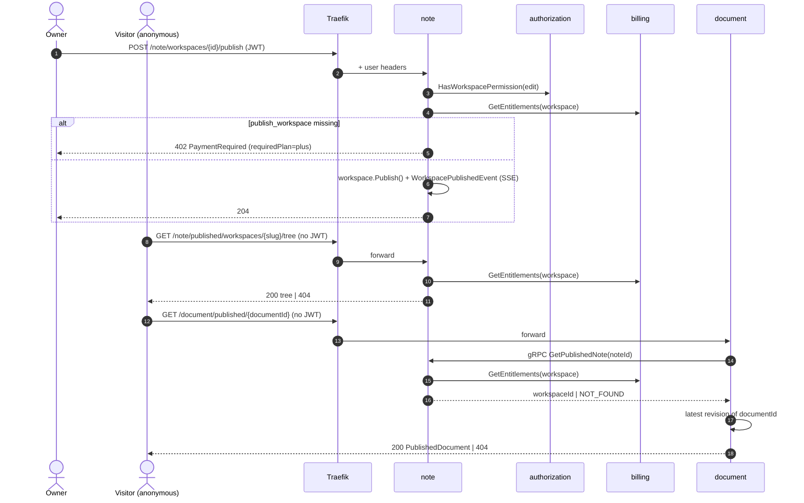
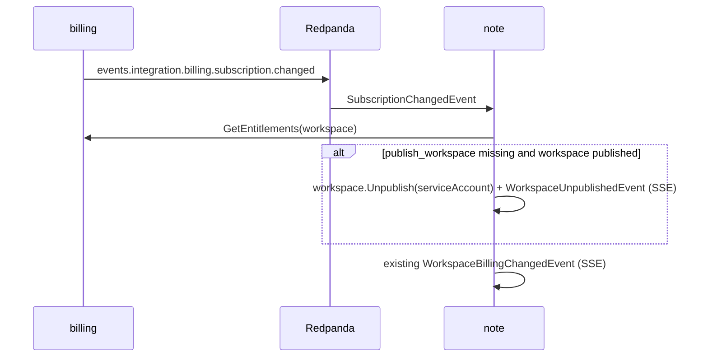

# Publish Workspace — Design

Date: 2026-11-01

## 1. Goal

A workspace owner on **plus** or **pro** can publish the workspace. Anyone, without signing in,
can then browse its folder tree and read every non-trashed note. Content shown is the note's
**latest revision**, not the live Yjs document. Unpublishing, or losing the plan, hides it again.

### Non-goals

- Publishing a single note. `POST /notes/{id}/publish|unpublish` and `cmd_publishnote.go` stay
  as they are (stubs); the `published_notes` limit stays in billing, unused.
- Live (websocket) public viewing.
- Public search, public graph, SEO metadata, HTTP caching of public responses.
- Caching billing / note state in consumers (tracked in `README.md` TO-DO).

## 2. Decisions

| #   | Decision                                                                                                                                                                                                                                       |
| --- | ---------------------------------------------------------------------------------------------------------------------------------------------------------------------------------------------------------------------------------------------- |
| D1  | New billing feature `publish_workspace`: free ✗, plus ✓, pro ✓.                                                                                                                                                                                |
| D2  | **note** owns the published flag, the publish/unpublish commands and the gate. It is the only service that answers "is this note publicly readable".                                                                                           |
| D3  | Publish requires `workspace:edit` (owner only, `policy.csv`), then `publish_workspace` → 402. Permission is checked first, so 403 wins over 402. Unpublish requires only `workspace:edit`.                                                     |
| D4  | Every public read re-checks: workspace published, not deleted, and `publish_workspace` still in the plan (uncached gRPC). This is the guarantee; it covers past-due grace expiry, which emits no event.                                        |
| D5  | On `billing.subscription.changed`, note calls `GetEntitlements` (ignores the payload's `plan`, which is the subscription's plan, not the effective one) and unpublishes when the feature is gone. Keeps the stored flag tidy; not relied on.   |
| D6  | **document** serves content: `GET /document/published/{documentId}` returns the latest revision. It asks note over gRPC (`GetPublishedNote`) and never checks billing itself.                                                                  |
| D7  | Anything not public returns **404** (never 403/402), so outsiders cannot probe for unpublished workspaces or notes. A published note with no revision yet also returns 404; the web shows "not published yet" because the note is in the tree. |
| D8  | Public routes live under a dedicated `published` prefix per service (`/note/published/...`, `/document/published/...`), so Traefik exposes them with one `PathPrefix` rule each, without the `jwt` middleware.                                 |
| D9  | Attachments need nothing: the RustFS `document` bucket is already anonymous-read.                                                                                                                                                              |

**Spec deviation:** `2026-10-11-billing-04-enforcement-design.md` lists `cmd_publishworkspace.go`
as "Not gated". This spec reverses that; the row is updated (§8).

### Naming: `documentId` vs `noteId`

A note is the metadata (name, icon, folder, tags) owned by note; the document is its content,
owned by document. They share the same id. The document service names its resource
`documentId` everywhere (`/document/documents/{documentId}/commit`), so its public endpoint does
too: `/document/published/{documentId}`. The web passes the tree's note id as `documentId`.

## 3. Flows



Downgrade:



## 4. Contract (API-first)

Run `nx gen api` and `nx gen proto` before any handler work.

### 4.1 note — owner endpoints (existing paths, updated)

`api/note/paths/workspaces_{workspaceId}_publish.yaml`

```yaml
# vim: ft=yaml.openapi
post:
  security:
    - Oauth2:
        - openid
    - OIDC:
        - openid
  tags:
    - Workspace
  summary: Publish workspace
  description: >
    Owner only. Requires feature `publish_workspace` (plus, pro); free returns 402.
    Idempotent: publishing a published workspace returns 204.
  operationId: publishWorkspace
  parameters:
    - $ref: ../components/parameters/workspaceIdPath.yaml
  responses:
    204:
      description: Workspace published
    400:
      $ref: ../../common/components/responses/BadRequestError.yaml
    401:
      $ref: ../../common/components/responses/UnauthorizedError.yaml
    402:
      $ref: ../../common/components/responses/PaymentRequired.yaml
    403:
      $ref: ../../common/components/responses/ForbiddenError.yaml
    404:
      $ref: ../../common/components/responses/NotFoundError.yaml
    500:
      $ref: ../../common/components/responses/InternalServerError.yaml
    503:
      description: Billing service unavailable
      content:
        application/json:
          schema:
            $ref: ../../common/components/schemas/Error.yaml
          example:
            code: SERVICE_UNAVAILABLE
            message: Billing service unavailable. Please try again later
```

`api/note/paths/workspaces_{workspaceId}_unpublish.yaml`: same shape, `operationId:
unpublishWorkspace`, description "Owner only. Idempotent.", no `402`/`503`.

`api/note/components/schemas/Workspace.yaml`: add

```yaml
publishedAt:
  type: [string, 'null']
  format: date-time
  description: When the workspace was published; null when not published
  examples: [2026-11-01T12:00:00Z]
  readOnly: true
```

and add `publishedAt` to `required`. Returned by `getWorkspace` (by slug) and anywhere else
`Workspace.yaml` is used, so the settings page knows the current state.

### 4.2 note — SSE event

`api/note/components/schemas/WorkspacePublicationChangedEvent.yaml`, modelled on
`WorkspaceRenamedEvent.yaml`:

```yaml
# vim: ft=yaml.openapi
type: object

properties:
  id:
    type: string
    format: uuid
    examples: [dd57d134-d23b-457f-88fc-a4d7d6b284e5]

  event:
    type: string
    enum:
      - WorkspacePublicationChangedEvent
    examples: [WorkspacePublicationChangedEvent]

  data:
    type: object
    x-go-type-name: WorkspacePublicationChangedEventData
    properties:
      id:
        $ref: ./Workspace.yaml#/properties/id
      publishedAt:
        $ref: ./Workspace.yaml#/properties/publishedAt
    required:
      - id
      - publishedAt

required:
  - id
  - event
  - data
```

Added to the `oneOf` and the discriminator `mapping` in `workspaces_{workspaceId}_events.yaml`.

### 4.3 note — public endpoints (new)

New tag `Published` ("Public read-only access to published workspaces").

```yaml
/note/published/workspaces/{workspaceSlug}:
  $ref: ./paths/published_workspaces_{workspaceSlug}.yaml
/note/published/workspaces/{workspaceSlug}/tree:
  $ref: ./paths/published_workspaces_{workspaceSlug}_tree.yaml
```

`api/note/paths/published_workspaces_{workspaceSlug}.yaml`

```yaml
# vim: ft=yaml.openapi
get:
  security: []
  tags:
    - Published
  summary: Get published workspace
  description: 404 when the workspace does not exist, is not published, or its plan no longer includes `publish_workspace`.
  operationId: getPublishedWorkspace
  parameters:
    - $ref: ../components/parameters/workspaceSlugPath.yaml
  responses:
    200:
      description: OK
      content:
        application/json:
          schema:
            $ref: ../components/schemas/PublishedWorkspace.yaml
    400:
      $ref: ../../common/components/responses/BadRequestError.yaml
    404:
      $ref: ../../common/components/responses/NotFoundError.yaml
    500:
      $ref: ../../common/components/responses/InternalServerError.yaml
    503:
      description: Billing service unavailable
      content:
        application/json:
          schema:
            $ref: ../../common/components/schemas/Error.yaml
```

`api/note/paths/published_workspaces_{workspaceSlug}_tree.yaml`: same shape,
`operationId: getPublishedWorkspaceTree`, parameters `workspaceSlugPath` plus the existing
`rootFolderId` and `depth` query params of `getWorkspaceTree` (no `includeTrashed`; trashed
items are never public; sort fixed to name asc), `200` → `WorkspaceTreeFolder.yaml` (reused).

`api/note/components/schemas/PublishedWorkspace.yaml`

```yaml
# vim: ft=yaml.openapi
type: object
description: Public view of a workspace. No members, billing or internal ids beyond the workspace id.
properties:
  id:
    $ref: ./Workspace.yaml#/properties/id
  slug:
    $ref: ./Workspace.yaml#/properties/slug
  name:
    $ref: ./Workspace.yaml#/properties/name
  publishedAt:
    type: string
    format: date-time
    readOnly: true
required: [id, slug, name, publishedAt]
```

### 4.4 document — public endpoint (new)

New tag `Published`.

```yaml
/document/published/{documentId}:
  $ref: ./paths/published_{documentId}.yaml
```

`api/document/paths/published_{documentId}.yaml`

```yaml
# vim: ft=yaml.openapi
get:
  security: []
  tags:
    - Published
  summary: Get published document
  description: >
    Latest revision of a note in a published workspace. 404 when the note is not public
    (workspace not published, plan lost, note trashed) or has no revision yet.
  operationId: getPublishedDocument
  parameters:
    - $ref: ../components/parameters/documentIdPath.yaml
  responses:
    200:
      description: OK
      content:
        application/json:
          schema:
            $ref: ../components/schemas/PublishedDocument.yaml
          example:
            $ref: ../components/examples/DocumentContent.json
    400:
      $ref: ../../common/components/responses/BadRequestError.yaml
    404:
      $ref: ../../common/components/responses/NotFoundError.yaml
    500:
      $ref: ../../common/components/responses/InternalServerError.yaml
    503:
      description: Note or billing service unavailable
      content:
        application/json:
          schema:
            $ref: ../../common/components/schemas/Error.yaml
```

`api/document/components/schemas/PublishedDocument.yaml`

```yaml
# vim: ft=yaml.openapi
type: object
description: Content of the latest revision. Author and contributor ids are deliberately omitted.
properties:
  documentId:
    type: string
    format: uuid
  revisionId:
    $ref: ./Revision.yaml#/properties/id
  committedAt:
    $ref: ./Revision.yaml#/properties/createdAt
  content:
    $ref: ./DocumentContent.yaml
required: [documentId, revisionId, committedAt, content]
```

### 4.5 billing

`api/billing/components/schemas/Features.yaml`: description and example gain
`publish_workspace`. No proto change (`map<string, bool>`).

### 4.6 proto — `proto/note/note.proto`

```proto
service NoteService {
  …
  // Public-read gate for document: NOT_FOUND unless the note is non-trashed, its workspace is
  // published, not deleted, and the plan includes publish_workspace. UNAVAILABLE when billing is down.
  rpc GetPublishedNote(GetPublishedNoteRequest) returns (GetPublishedNoteResponse);
}

message GetPublishedNoteRequest {
  string note_id = 1 [
    (buf.validate.field).required = true,
    (buf.validate.field).string.uuid = true
  ];
}

message GetPublishedNoteResponse {
  string workspace_id = 1 [
    (buf.validate.field).required = true,
    (buf.validate.field).string.uuid = true
  ];
}
```

## 5. Per-service changes

### billing (`internal/billing`)

- `domain/types.go`: `FeatureKeyPublishWorkspace` (`"publish_workspace"`), in `FeatureKeys`,
  `IsValid`, `String`.
- `DefaultPlans`: free `false`, plus/pro `true`.
- **Backfill:** `EnsureDefaults` only inserts missing tiers, and stored plans load through
  `UnmarshalPlan` without defaults, so existing plus/pro would read `false`. Add a domain method
  `Plan.AddMissingKeys(defaults *Plan, userID)` that copies only keys absent from the plan (never
  overwrites admin-edited values) and records `PlanUpdatedEvent` when something was added;
  `EnsureDefaults` calls it for existing tiers. Idempotent, so `just seed` fixes existing DBs.
- Docs: add the row to §3 of `2026-10-11-billing-03-billing-service-design.md`.

### note (`internal/note`)

- Migration `00003_workspace_published.sql`: `ALTER TABLE workspaces ADD COLUMN published_at
  TIMESTAMPTZ;` sqlc queries for workspace read/write gain the column.
- Domain `Workspace`: `publishedAt *time.Time`, `UnmarshalWorkspace` gains it,
  `PublishedAt()`, `IsPublished()`, `Publish(now, userID)` / `Unpublish(userID)`, no-op (no event)
  when already in that state. Events `WorkspacePublishedEvent{PublishedAt}`,
  `WorkspaceUnpublishedEvent`, mapped in `component/eventtopic.go`.
- `app/plan.go`: `PlanFeaturePublishWorkspace` (`"publish_workspace"`).
- `cmd_publishworkspace.go`: fields become `ID uuid.UUID, UserID string` (today `Slug`, which
  does not match the API path). Order: permission (`WorkspacePermissionEdit`) → entitlement
  (`errs.NewFeatureNotInPlan` with `RequiredPlanForFeature`, as `q_getworkspacegraph.go`) →
  `GetByID(forUpdate)` → `Publish` → `Save`.
- `cmd_unpublishworkspace.go`: `ID`, `UserID`; permission → load → `Unpublish` → `Save`.
- `cmd_revokepublication.go` (new): input `WorkspaceID`. `GetEntitlements`; if the feature is
  missing and the workspace is published, `Unpublish(serviceAccountUserID)`. No permission check
  (system actor, like the trash purge).
- `controller/event/billingchanged.go`: dispatch the decoded event to `RevokePublication` and the
  existing `BillingChanged` (SSE).
- `e_notifyworkspacepublicationchanged.go` (new): domain published/unpublished →
  `WorkspacePublicationChangedEvent` on the workspace SSE channel, like
  `e_notifyworkspacerenamed.go`.
- Public queries, all returning `errs.NotFound` for anything not public (D7):
  - shared helper `loadPublishedWorkspace(ctx, slug|id)` in `app/publishgate.go`: workspace exists,
    not deleted, `IsPublished()`, `GetEntitlements` has the feature. Billing errors propagate
    (→ 503), they are not turned into 404.
  - `q_getpublishedworkspace.go` (by slug).
  - `q_getpublishedworkspacetree.go`: the gate, then the existing tree read model with
    `includeTrashed=false`, name asc.
  - `q_getpublishednote.go`: note's workspace (read model), note not trashed, then the gate.
- HTTP: implement `PublishWorkspace` / `UnpublishWorkspace` in
  `controller/http/workspace.go`; new `controller/http/published.go` for the public operations
  (they never call `commonhttp.UserFromContext`).
- gRPC: `GetPublishedNote` in `controller/grpc`, `errs.NotFound` → `NOT_FOUND`, billing
  unavailable → `UNAVAILABLE`.
- `AGENTS.md`: replace the `published_notes` TODO line with the `publish_workspace` gate and the
  public-read rule.

### document (`apps/document`)

- `note/note.service.ts`: `getPublishedNote(noteId)` → `{ workspaceId } | null` (`null` on
  `NOT_FOUND`; `UNAVAILABLE` → 503 exception, as the billing client does).
- `published/published.api.ts` (new module), extends the generated `PublishedApi`:
  `getPublishedDocument(documentId)` → `noteService.getPublishedNote` → latest revision with
  content (`DocumentService`, extend `getLatestRevisionId` into a content-returning read) → 404
  when either is missing.
- The global `HttpUserGuard` rejects requests without gateway headers. Add a `@Public()`
  metadata decorator that the guard honours, applied to `PublishedApi` only.

### gateway (`deploy/compose/infrastructure/traefik/dynamic`)

- `note.yaml`: router `note-published`, `PathPrefix(/note/published)`, middlewares `cors` only;
  main `note` router gains `&& !PathPrefix(/note/published)`.
- `document.yaml`: `document-public` rule becomes
  `PathPrefix(/document/ws/document) || PathPrefix(/document/published)`; main router excludes
  `/document/published`.
- Public handlers never read `X-Forwarded-*`, so client-sent spoofed headers are harmless there.

### web (`apps/web`)

- Public pages outside `proxy.ts`'s `/workspace/:path*` matcher, so no sign-in redirect:
  - `app/(published)/p/[workspaceSlug]/page.tsx`: workspace name + tree sidebar.
  - `app/(published)/p/[workspaceSlug]/[noteId]/page.tsx`: read-only BlockNote render of
    `content`; "not published yet" state on 404 when the note is in the tree.
  - Unknown/unpublished workspace → `not-found.tsx`.
- `settings/general`: owner-only "Publish workspace" switch + copyable public link
  (`/p/{slug}`); 402 opens the existing upgrade prompt; state from `Workspace.publishedAt`,
  refreshed by `WorkspacePublicationChangedEvent`.
- Note: changing the slug breaks existing public links (accepted).

## 6. Error handling

| Case                                                       | Response                                                               |
| ---------------------------------------------------------- | ---------------------------------------------------------------------- |
| Publish by non-owner                                       | 403                                                                    |
| Publish on free                                            | 402 `PaymentRequiredError`, `requiredPlan=plus`                        |
| Billing down on publish or public read                     | 503 (never 404, so a billing outage is not mistaken for "unpublished") |
| Public read: not published / deleted / trashed / plan lost | 404                                                                    |
| Published note without a revision                          | 404 from document                                                      |
| `RevokePublication` fails (billing down)                   | Returned to Watermill, message retried; reads stay correct via D4      |

## 7. Testing

- billing: `Plan.AddMissingKeys` (adds missing, keeps edited values, no event when nothing added);
  `EnsureDefaults` backfills existing tiers.
- note domain: `Publish`/`Unpublish` state + events, no-op cases.
- note app (testify + mockery mocks of `AuthorizationSvc`, `BillingSvc`):
  publish 403 before 402, 402 on free, success; `RevokePublication` unpublishes only when the
  feature is missing; public gate returns 404 for each not-public case and 503 on billing error.
- document: `getPublishedDocument` 404 on `null` from note, 404 on no revision, 200 shape.
- Manual: publish on plus, open `/p/{slug}` signed out, cancel subscription in Stripe sandbox,
  confirm the workspace is unpublished and the page 404s.

## 8. Docs to update

- `docs/superpowers/specs/2026-10-11-billing-03-billing-service-design.md` §3: `publish_workspace` row.
- `docs/superpowers/specs/2026-10-11-billing-04-enforcement-design.md` note table:
  `cmd_publishworkspace.go` → "`publish_workspace` feature (see 2026-11-01-publish-workspace-design)".
- `internal/note/AGENTS.md` entitlement gates section.
- `docs/src/services/note/flows.md`: publish + public read sequence.
- `README.md` TO-DO: the "planned" public-read entries are added already.
