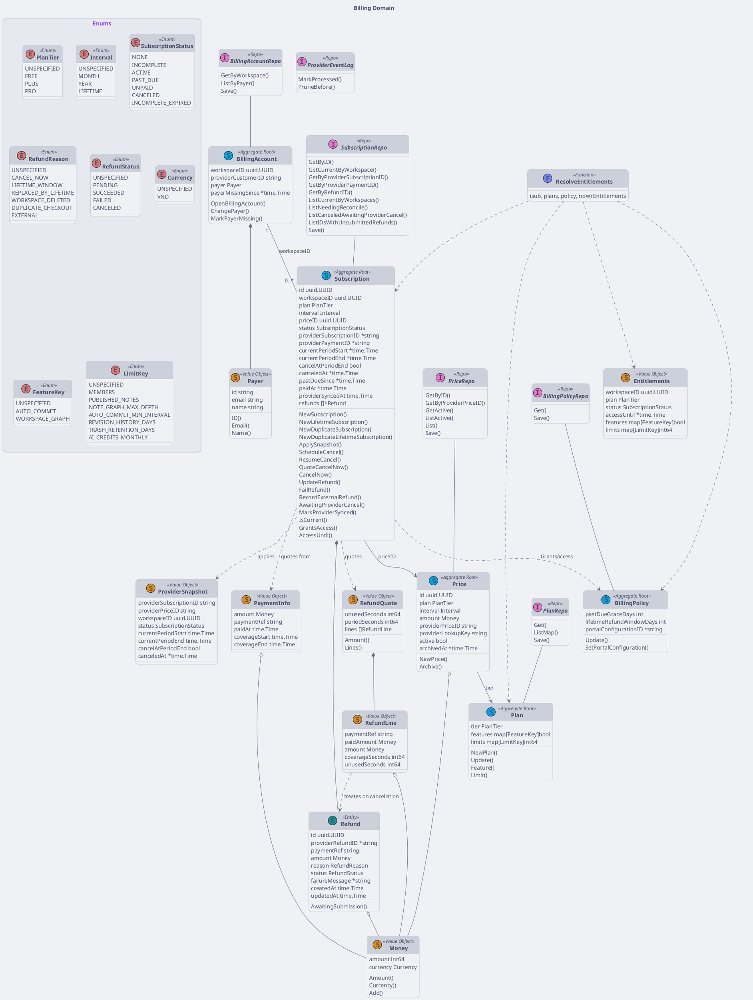
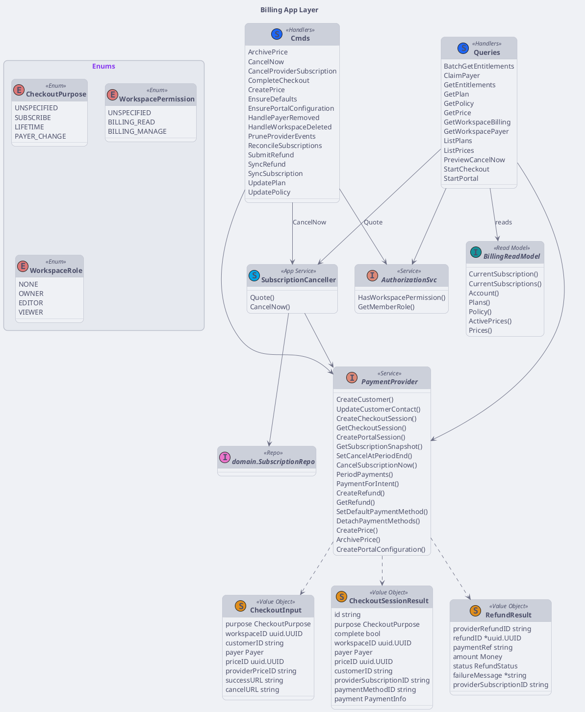

# Billing Class Diagram

:::info

* Golang syntax
* Apply DDD, CQRS, repository pattern, clean architecture
* Derived from `internal/billing/domain` and `internal/billing/app`

:::

## Domain Layer

`BillingAccount` owns the payer's recorded contact details; `Subscription` owns its
refunds and references a catalog `Price`. The subscription's plan and interval are the
purchased terms. Provider snapshots describe Stripe state, and payment coverage belongs
to each payment, not the subscription's current period. A refund keeps its payment
reference and amount after the temporary quote is gone.

## Application Layer

`CancelNow` only records the local cancellation and refund requests. The provider side effects are separate commands driven by billing's own outbox events (see [Flows](./flows#cancel-now)).

