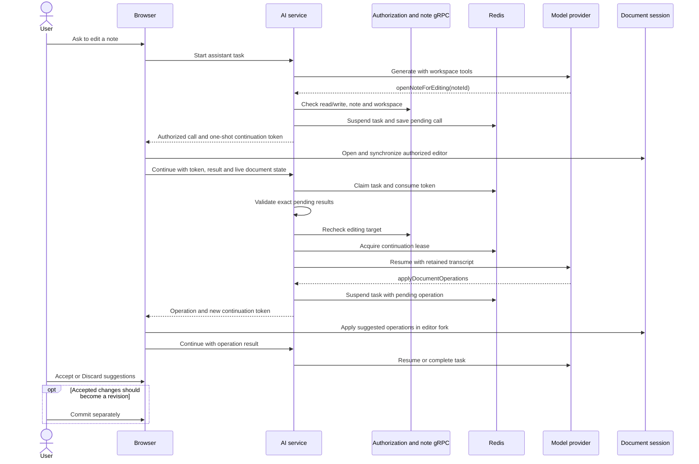

# AI service flows

These flows describe the implementation behind the [AI service overview](./). The browser
reaches AI through Traefik; the model never receives authority to select the billing workspace
or directly edit a document.

## Initial generation and accounting

```mermaid
sequenceDiagram
    actor User
    participant Browser
    participant Gateway as Traefik
    participant AI as AI service
    participant Auth as Authorization and note gRPC
    participant Billing as Billing gRPC
    participant Redis
    participant Model as Model provider

    User->>Browser: Submit prompt
    Browser->>Gateway: POST /ai with context and UI messages
    Gateway->>AI: Forward authenticated user ID
    AI->>AI: Validate request and final user prompt
    AI->>Redis: Throttle user
    AI->>Auth: Resolve workspace and check permissions
    AI->>Billing: Fetch monthly workspace allowance
    AI->>Redis: Reserve credit and stream lease; deduplicate message ID
    opt Assistant mode
        AI->>Redis: Create bounded task
    end
    AI->>Redis: Mark reservation started
    AI->>Model: Stream generation and tool steps
    AI-->>Browser: AI SDK UI-message stream
    AI->>Redis: Release stream lease
```

Context can be a workspace ID, a note ID, or `X-Workspace-Id`. A note ID is resolved
using the requesting user; conflicting contexts are rejected. Without context, exactly
one accessible workspace is required. Read permission is required before billing, and
client editing definitions require write permission.

The reservation covers one initial generation, including tool steps and assistant
continuations. Confirmed failure or cancellation before start can refund it; after start
the charge remains even on provider error, timeout, or disconnect. Duplicate user message
IDs within the user/workspace/month return `409`, not a replay. Usage resets at the first
of the month in UTC. Errors before streaming are JSON; after headers they are safe stream
error parts.

## Search and indexed reads

```mermaid
sequenceDiagram
    participant Model
    participant AI as AI server tool
    participant Auth as Authorization gRPC
    participant Search as Meilisearch
    participant Note as Note gRPC

    Model->>AI: searchNotes or readIndexedNoteContent
    AI->>Auth: Recheck workspace read access
    alt Search
        AI->>Search: Query within validated workspace
        Search-->>AI: Candidate hits
        AI->>Note: Check each note and its workspace for user
    else Indexed content read
        AI->>Note: Check note and workspace for user
        AI->>Search: Read bounded indexed content
    end
    AI-->>Model: Authorized results
```

Unavailable, trashed, or out-of-workspace notes are not returned as usable results.
Indexed content is committed content and may be stale or truncated. `getNote` supplies
metadata rather than live content. Tool errors are sanitized before reaching the model.

## Assistant editing handoff



The diagram shows a typical edit; a task can finish without a client handoff or repeat
continuations. The browser waits for an authenticated synchronized session before returning
live state. Hocuspocus enforces document authorization. Accept merges suggestions, Discard
preserves collaborator changes, and Commit creates a revision; automatic commits depend on
workspace plan and settings.

Each continuation is bound to the task owner, workspace, and recorded calls. The server
retains the transcript and validates results rather than accepting replacement history.
Continuations recheck access and acquire rate/concurrency capacity, but do not recheck
billing or spend another monthly credit. The original deadline and cumulative model-step
budget remain in force. A cancel request invalidates the task between streams.
