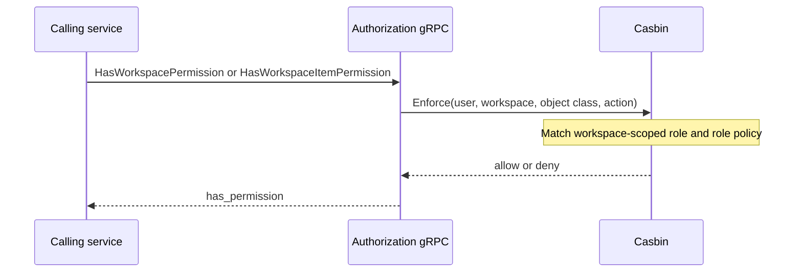
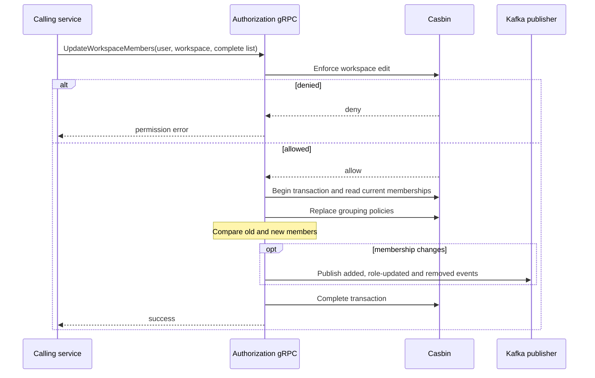
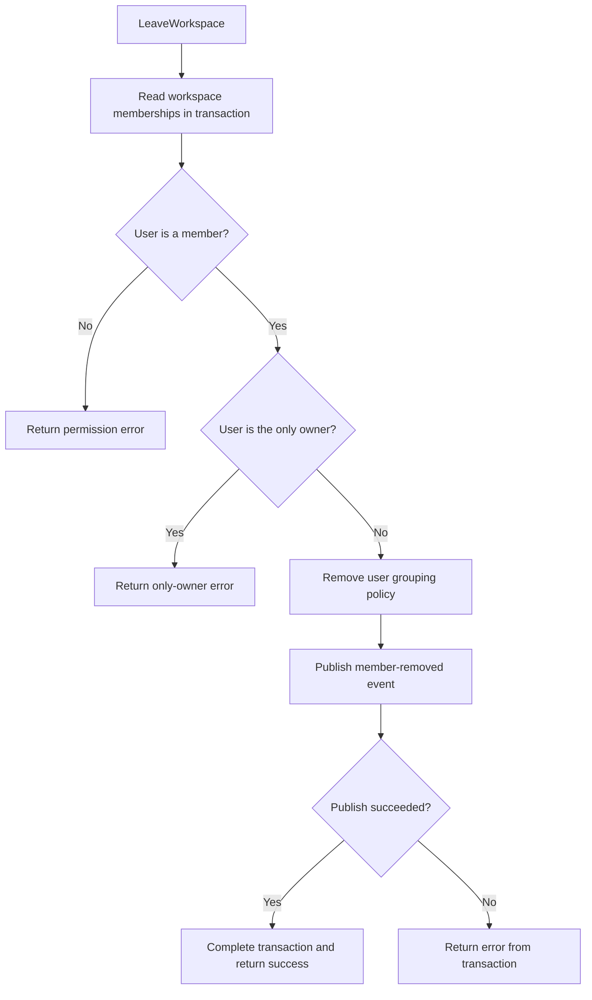

# Authorization Flows

These flows describe the internal gRPC service. See the [overview](./index) for the
complete use-case and role-permission summaries.

## Check a permission

An enforcement error is returned as an error rather than a denial. For the combined
`GetUserWorkspaceItemPermissions` query, the service first requires workspace read,
then batch-checks item read, write and delete. Unlike the single permission checks,
the combined query returns an error when workspace read is denied.

## Replace workspace members

Publishing happens inside the Casbin transaction callback, through a direct Kafka
publisher, not a transactional outbox. Events are published individually, so partial
publication is possible and delivery is not atomic with the membership transaction.
On a publishing error the callback returns an error, but the update gRPC handler logs
that specific error and returns success. Do not interpret that response as a guarantee
that either all events were delivered or the membership transaction committed.

## Leave a workspace

Unlike member replacement, leave propagates a publication error to the caller. The
direct publication is still not atomic with the Casbin transaction.

## Delete workspace authorization

`DeleteWorkspace` checks workspace delete permission before removing all grouping
policies for the workspace. It does not publish member-removal events in this handler;
workspace deletion and any related cleanup belong to the calling workflow.
