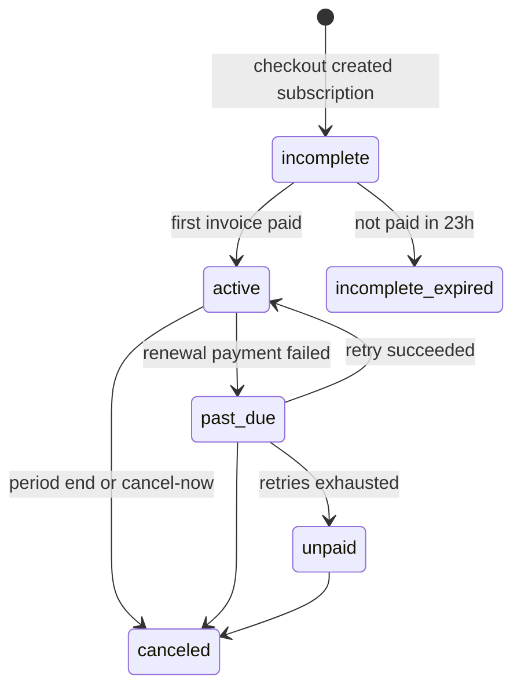
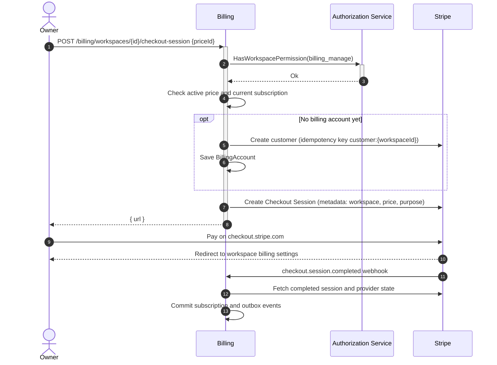
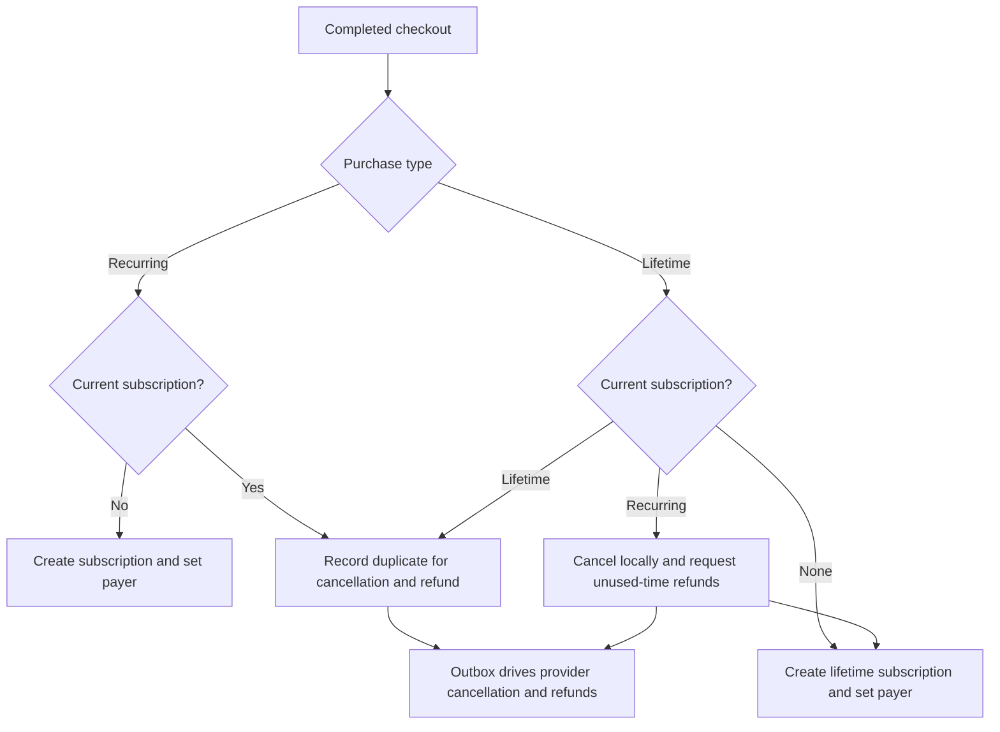
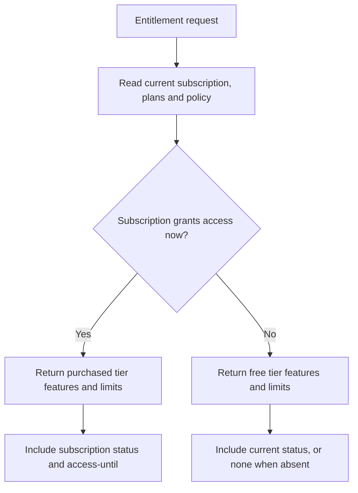
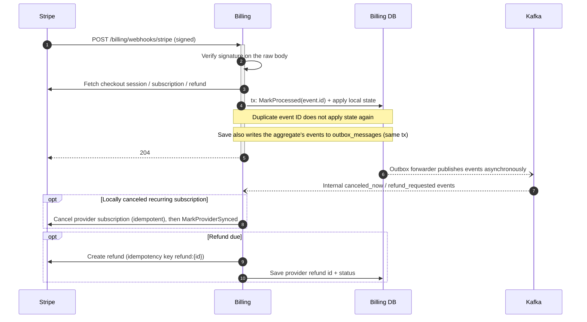
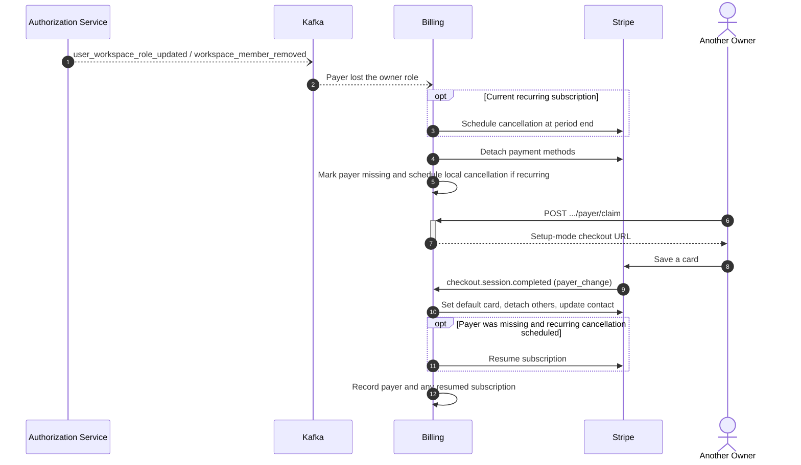

# Billing Flows

:::info

* Stripe runs in **sandbox** only: Stripe doesn't onboard Vietnamese businesses for live payouts. See [the payment provider story](/developer/story/BILLING_PAYMENT_PROVIDERS).
* Webhook handlers extract object IDs from the payload and fetch current state from Stripe instead of applying the payload as a snapshot.
* Entitlements are always read from billing's own database. Other services call gRPC on every check and never cache.

:::

## Subscription States



This is a simplified recurring-provider lifecycle, not an exhaustive transition graph. `past_due` keeps paid features until period end + `pastDueGraceDays` (billing policy, default 3). Lifetime purchases have no Stripe subscription: they're created `active` and can be canceled by the user within the refund window or on workspace deletion.

## Checkout



Checkout rejects archived prices and existing subscriptions, except a lifetime purchase replacing a
recurring subscription. The redirect itself does not update billing state. On webhook completion,
the billing account is locked to serialize concurrent checkouts:



If the recurring subscription changes between fetching its payments and locking it for replacement,
the transaction fails and webhook delivery can be retried.

## Customer Portal

A user with `billing_manage` can start a portal session for an existing billing account. Billing
requires a seeded portal configuration and returns a Stripe-hosted URL. Plan changes and
period-end cancellation made there reach the local subscription through subscription or invoice
webhooks; the return URL is not itself a synchronization operation. See
[Webhook Pipeline](#webhook-pipeline).

## Entitlement Resolution



HTTP requests check `billing_read`; internal consumers use the single or batch gRPC API. Resolution
uses the local database, not a synchronous Stripe request. A subscription may retain its status in
the response even when the free tier applies.

## Webhook Pipeline



Processing details:

1. Provider reads and idempotent mutations that must not be lost (change the default card) run **before** the write transaction. Checkout completion locks the workspace's billing account inside the transaction and decides duplicate / replace there, so concurrent checkouts of one workspace serialize.
2. For handled objects, the write transaction records the event (`processed_provider_events`) together with the state change and the outbox events. An unknown subscription can be acknowledged before checkout creates it; checkout fetches its own current snapshot. Unhandled event types are acknowledged and ignored.
3. **Phase 2** is driven by billing's own outbox events, consumed in `controller/event`: `subscription.canceled_now` runs `CancelProviderSubscription` (cancel at the provider, then `MarkProviderSynced`), and `subscription.refund_requested` runs `SubmitRefund` (`CreateRefund` keyed by the refund id; a provider `invalid` error marks the refund `failed`). A locally canceled row is never resurrected.
4. The hourly reconcile cron is the safety net: it retries provider cancels and refund submissions for rows still awaiting them.

## Cancel Now

```mermaid
sequenceDiagram
    autonumber

    actor U as Owner
    participant B as Billing
    participant S as Stripe
    participant DB as Billing DB

    U->>+B: GET .../subscription/cancel-now/preview
    B->>S: Period payments (recurring) / payment intent (lifetime)
    B-->>-U: Refund quote
    U->>+B: POST .../subscription/cancel-now
    B->>DB: tx: Subscription canceled + any pending refunds + outbox events
    B-->>-U: Workspace billing (subscription: null)
    opt Recurring subscription
        DB--)B: outbox: subscription.canceled_now
        B->>S: Cancel subscription now, then MarkProviderSynced
    end
    opt Positive refund lines
        DB--)B: outbox: subscription.refund_requested
        B->>S: Create refund (refund:{id})
        B->>DB: Save provider refund ID and status
        S->>B: Refund webhook; fetch and sync status
    end
```

Recurring refunds are prorated per payment's own coverage window, capped by the amount not already
refunded. Lifetime purchases are refundable within the policy window; after it expires user
cancel-now is rejected. Preview is not a reservation: cancel-now fetches payments and calculates a
fresh quote. Refunds can remain pending, succeed, fail, or be canceled.

### Workspace deletion

The Note service's workspace-deleted event invokes the same local cancellation and asynchronous
provider/refund pipeline. If no current subscription exists it is a no-op. A lifetime subscription
outside its refund window is still canceled, but without a refund.

## Payer Removed and Claimed



Claiming requires `billing_manage` and an existing billing account; it is also available when the
previous payer is not missing, provided the caller is not already the recorded payer. Only events
affecting the recorded payer trigger removal handling.

## Crons

| Job                               | Schedule                   | Effect                                                                                                                             |
| --------------------------------- | -------------------------- | ---------------------------------------------------------------------------------------------------------------------------------- |
| `billing:reconcile-subscriptions` | hourly                     | Re-syncs subscriptions past their period end or not synced for 24 h; retries provider cancels and refund submissions still pending |
| `billing:prune-provider-events`   | daily 04:00 (process `TZ`) | Deletes processed webhook event ids older than 30 days                                                                             |

Both use a Redis lock (`billing_redis`), so with several billing instances each tick runs once.
