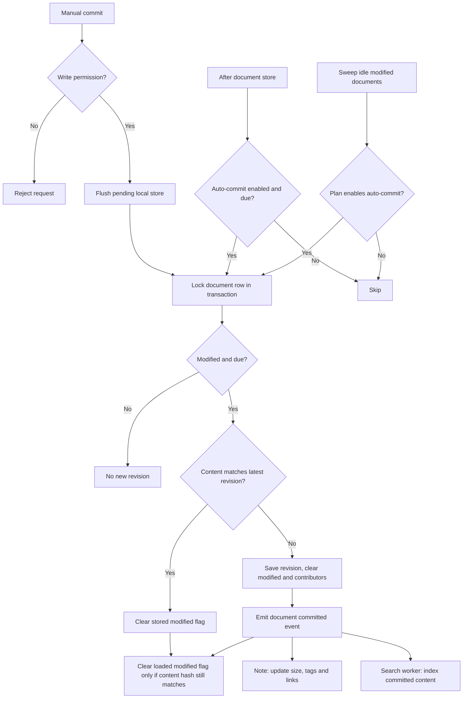

# Document flows

The [Document service](./index) owns collaborative content; the Note service owns note metadata.
Stored Yjs edits are not necessarily committed revisions.

## Connect and edit

```mermaid
sequenceDiagram
    actor User
    participant WS as Hocuspocus
    participant Auth as Authentication
    participant Note as Note service
    participant Permissions as Authorization service
    participant DB as Document database
    User->>WS: Connect with document ID and JWT
    WS->>Auth: Validate token
    WS->>Note: Get note for user
    WS->>Permissions: Get document permissions
    alt No read permission or note unavailable
        WS-->>User: Reject connection
    else Read allowed
        WS->>DB: Load stored Yjs state if present
        WS-->>User: Connect (read-only if no write or trashed)
        opt Writable connection
            User->>WS: Send Yjs changes
            WS->>WS: Mark modified and track contributor
            WS->>DB: Debounced store of state and modified flag
        end
    end
```

Role changes can switch a live connection between writable and read-only, or close it when read
access is lost. Membership removal closes affected connections. These updates apply to connections
observed by the event-consuming instance.

## Commit a document



Manual commit bypasses the interval gate but still requires modified content. It returns `201` with
the new revision ID, `200` with the latest ID when no new revision is created, or `204` if there is
no revision. Hash-equivalent content clears the stored modified flag without creating a revision;
pending contributors are retained for the next actual commit. Comparing the loaded content hash
before clearing its flag protects newer, not-yet-stored edits, including delete-only edits.

Auto-commit checks the workspace plan and its minimum interval; the sweeper forces commits of idle
modified documents only for plans with auto-commit enabled. When billing is unavailable these
background paths skip work rather than prevent editing. The Kafka emit occurs inside the database
transaction, but it is not a transactional outbox: database and event delivery are not atomic.
Search and note metadata reflect committed content, not every collaborative edit.

## Delete a note

```mermaid
sequenceDiagram
    participant Note as Note service
    participant Events as Kafka
    participant WS as Hocuspocus instance
    participant DB as Document database
    Note->>Events: Publish note deleted
    Events->>WS: Deliver deletion event
    WS->>WS: Guard loaded document against further stores
    WS->>WS: Close connections and wait for in-flight stores
    WS->>DB: Delete document
    DB->>DB: Cascade delete revisions
```

The guard prevents a final unload store from recreating a deleted document on the receiving
instance. In a scaled deployment, deletion must reach every instance holding that document; the
local guard alone does not provide cross-instance delivery.
