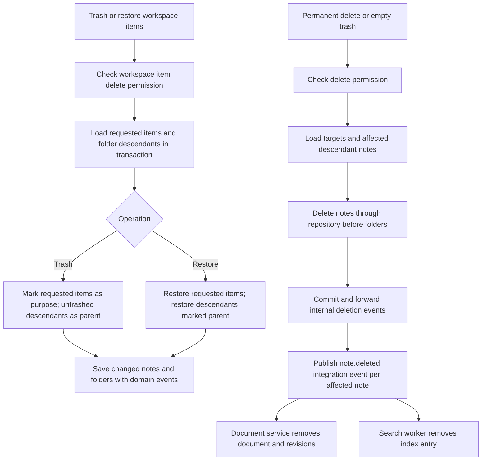
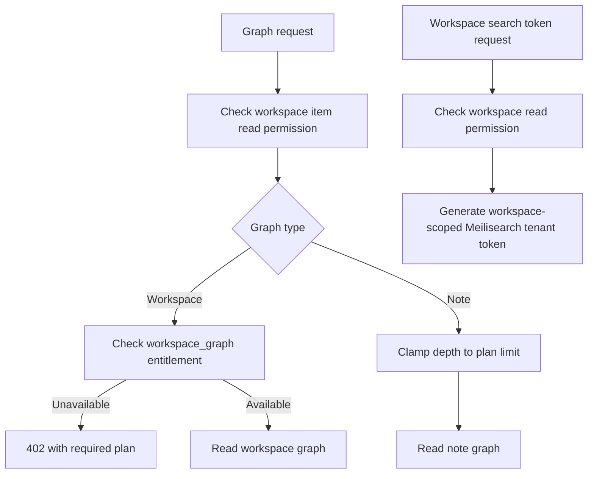

# Note Flows

The note service owns metadata; editable content and revisions belong to the [document service](../document/). These diagrams show important boundaries, not every validation or failure. For topic names and delivery details, see [Events](./events) and [Messaging](../../architecture/messaging).

## Create a workspace

```mermaid
sequenceDiagram
    actor User
    participant Note as Note service
    participant DB as Note database
    participant Auth as Authorization service
    User->>Note: Create workspace (name, slug)
    Note->>DB: Begin transaction; check slug
    alt Slug already exists
        Note-->>User: Conflict
    else Available
        Note->>DB: Save workspace and root folder
        Note->>Auth: Create workspace with owner
        Auth-->>Note: Result
        Note->>DB: Commit transaction
        Note-->>User: Created
    end
```

The authorization call is made inside the database transaction, but is not part of it: a successful authorization call followed by a failed commit can leave the services inconsistent.

## Create or update a note

```mermaid
sequenceDiagram
    actor User
    participant Note as Note service
    participant Auth as Authorization service
    participant DB as Note database and outbox
    participant Broker as Message broker
    participant Handler as Note event handlers
    participant SSE as Workspace SSE
    participant Search as Search worker
    User->>Note: Create note in folder
    Note->>DB: Begin transaction; find folder and workspace
    Note->>Auth: Check workspace item write permission
    alt Forbidden or folder missing
        Note-->>User: Error
    else Allowed
        Note->>DB: Save note and internal domain event
        Note->>DB: Commit
        Note-->>User: Created
        DB-->>Broker: Forward internal note.created
        Broker-->>Handler: Handle domain event
        Handler->>SSE: Publish workspace item update
        Handler->>Broker: Publish note.created integration event
        Broker-->>Search: Index note metadata
    end
```

These event handlers run asynchronously; the response does not wait for subscribers or search indexing. Updates such as rename, move, trash and restore similarly produce internal events. The integration update handler reads current note and folder state before publishing, and skips a note that no longer exists. See [Events](./events).

## Read and commit content

Note metadata is read through the note service after a workspace item permission check. The document service manages collaboration and revisions separately; see its [documentation](../document/).

```mermaid
sequenceDiagram
    actor User
    participant Document as Document service
    participant Broker as Message broker
    participant Note as Note service
    participant DB as Note repository
    participant Search as Search worker
    participant Index as Search index
    User->>Document: Commit document
    Document->>Document: Create revision if content changed
    Document->>Broker: Publish document.committed for new revision
    Document-->>User: Result
    Broker-->>Note: document.committed
    Note->>DB: Load note; update size, tags and outgoing links
    Note->>DB: Save note and domain events
    Broker-->>Search: document.committed
    Search->>Index: Update committed content and tags
```

The note and search consumers process the commit independently, so their updates need not be visible at the same time. A commit with no new revision does not emit this event. Automatic and scheduled commits can also trigger this path.

## Trash, restore and permanent deletion



Items already trashed independently remain independently trashed when their parent is trashed or restored. Permanent deletion is distinct from trashing; downstream cleanup is asynchronous.

### Automatic retention purge

The `note:purge-expired-trash` cron uses a distributed lock and runs as the service account (default 03:00 local time). It finds candidate workspaces, fetches billing entitlements in a batch, and purges explicitly trashed items older than the workspace's `trash_retention_days`, with a minimum age of 24 hours. Deleting an expired folder also deletes its descendant notes. Unlimited retention or missing entitlements skips that workspace; a billing failure skips the batch. Per-workspace failures are logged and do not stop the remaining workspaces.

## Update workspace members

```mermaid
sequenceDiagram
    actor User
    participant Note as Note service
    participant Auth as Authorization service
    participant Billing as Billing service
    participant SSE as Workspace SSE
    User->>Note: Replace member list
    Note->>Note: Require nonempty list and at least one owner
    Note->>Auth: Check workspace edit permission and read current members
    Note->>Billing: Check member limit and payer protection
    alt Limit exceeded or protected payer removed/demoted
        Note-->>User: 402 or 409
    else Allowed
        Note->>Auth: Update members
        Note->>SSE: Publish members updated
        Note-->>User: Result
    end
```

The member limit blocks growth, not removals or role changes after a downgrade. A protected payer cannot be removed or demoted while billing requires one. Permission is checked before billing gates; billing unavailability returns 503. Membership update and SSE publication are separate side effects, not one transaction.

## Graphs and search



Billing failure returns 503 for graph queries. A note graph request above its plan's depth limit is clamped rather than rejected. Search tokens are scoped by the note service; search indexing is asynchronous.
